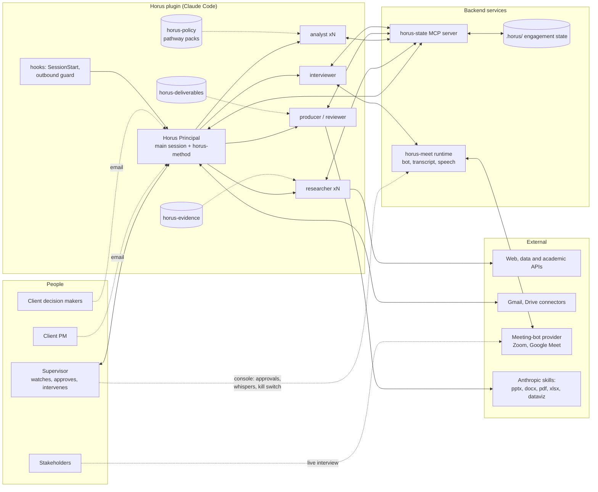

# Horus MVP — Plugin Architecture

| | |
|---|---|
| **Version** | 0.3 — MeetStream as the meeting provider; scheduling, directives and email with attachments in the MVP |
| **Date** | 25 October 2026 |
| **Status** | Design only. No implementation code exists yet. |
| **Companions** | [STATE_SCHEMA.md](STATE_SCHEMA.md) — project-state schema and backend API · [BENCHMARKS.md](BENCHMARKS.md) — sourced deliverable benchmarks |

## 0. The design in one screen

Horus ships as **one Claude Code plugin** and **one small backend** with two services.

- The plugin turns a Claude Code session into the **Horus Principal**: a single senior policy consultant who executes an engagement end to end, from RFP to final recommendation, through **six client alignment points**. Horus does the consulting work; a human **Supervisor** watches, approves sensitive outbound actions and intervenes when necessary.
- After intake the Principal **classifies the problem and selects an advisory pathway**: regulatory, strategy, institutional and operating model, transformation and delivery, public investment and business case, or programme and service design. The six phases are common to all pathways; the analytical method, the appraisal technique and the core deliverables adapt to the pathway. Regulatory impact assessment is one pathway's appraisal method, not the architecture.
- The Principal delegates parallelisable, context-heavy or real-time work to **four workers**: `researcher` (evidence into the ledger), `analyst` (quantitative appraisal and modelling), `producer` (rendering, QA, independent review) and `interviewer` (conducts live stakeholder interviews in Zoom or Google Meet as a disclosed AI participant).
- Everything Horus knows about the engagement lives in a **structured, file-based engagement state** (`.horus/`), read and written through the **`horus-state`** MCP server, which validates records against a schema, assigns IDs, keeps an audit log and computes views such as status, gate readiness and traceability.
- A second service, **`horus-meet`**, is the live-meeting runtime built on **MeetStream**: the bot joins Google Meet or Zoom from a link, MeetStream posts live transcript sentences and status changes to Horus and opens a control websocket through which Horus speaks (text-to-speech as 48 kHz PCM), interrupts and posts chat; the runtime carries Supervisor whispers and the kill switch and writes the meeting facts back to state. Horus also schedules meetings by email (proposing slots, reading replies and invites), captures documents and directives given in calls, and reads and sends email with attachments. Avatars and screen-shared presenting stay in Phase 2.
- Four **skills** carry the method: `horus-method` (lifecycle, pathway selection, gates, alignment protocol, live-meeting playbook, supervision and state discipline, frameworks catalogue), `horus-evidence` (source grading, cross-checking, profiling, sentiment, interview capture), `horus-policy` (pathway packs, option design, appraisal methods including RIA, implementation and communication planning), `horus-deliverables` (MBB production standard and QA).
- Two **hooks** give continuity and safety: `SessionStart` injects the engagement status; a `PreToolUse` guard holds outbound emails and messages until a recorded approval exists.
- The MBB bar is enforced by a **deliverable system**: one storyline drives a tiered set (Tier 0 decision memo and five-slide brief for the head of government; Tier 1 executive deck; Tier 2 the pathway's core documents), produced from storyboards and passed through five QA audits plus an unanchored partner review before release.

Component count: **1 Principal · 4 skills · 4 workers · 2 MCP servers (`horus-state`, `horus-meet`) · 2 command-line tools (`horus`, `horus-mail`) · 3 hooks**. The MeetStream Claude plugin (`meetstream-ai-meeting-bot-api`) is installed alongside as the provider's reference documentation.

### 0.1 What changed from version 0.1

| Review comment | Change |
|---|---|
| Autonomous meetings belong in the MVP | New `horus-meet` runtime (§5.5) and `interviewer` worker (§5.4); Horus conducts stakeholder interviews itself and co-leads gate meetings; the `meetings` record gains disclosure, consent, transcript and intervention fields |
| Use MeetStream; schedule, receive documents and directives in calls, handle email with attachments (second review) | `horus-meet` rebuilt on MeetStream's bridge websocket and webhooks (§5.5); scheduling protocol by email with invite parsing (§5.8, §6.3); `mark` events and capture rules for documents and directives given in calls (§5.5); `horus-mail` for attachments the Gmail connector cannot download (§5.8); `meeting_scheduling` action class (§3.1) |
| Operator becomes Supervisor; design for shadow mode | Supervision model with action classes and autonomy levels (§3.1); approvals become a first-class collection; intervention channels (approve, whisper, pause, leave, directive); shadow mode is a settings profile, not a redesign |
| General advisory, not RIA-centric | Problem classification at the end of intake (§4.1), six advisory pathways with packs (§4.2), the `horus-policy` skill and `analyst` worker generalised to appraisal methods, `impact_assessments` renamed `appraisals`, `policy_options` renamed `options`, deliverable core sets per pathway (§7.1) |

Section 13 lists the decisions I need from you before building.

## 1. Design principles

1. **Horus executes; the Supervisor supervises.** The firm's thesis is an AI-native advisory, not AI-assisted consultants. Horus researches, analyses, interviews, writes and presents. The Supervisor approves what is sensitive, watches the rest, and can stop or redirect at any moment. Every autonomy level is a setting, so an engagement can move from closely supervised to shadow mode without changing the design.
2. **One mind, many hands.** Judgment is never split across agents. The Principal frames the problem, selects the pathway, forms hypotheses, writes every storyline and interview guide, interprets politics, chooses the recommendation and signs off quality. Workers execute written briefs with explicit contracts and return summaries, not raw material.
3. **State is the product.** If it is not in the engagement state, it did not happen. Every evidence item, interview turn, client comment, decision, open question, approval and deliverable version is a typed record with provenance.
4. **Evidence discipline.** Sources graded A to E, a two-source rule for every figure, snapshots at retrieval, and traceability from every number in a deliverable to a source. Interview statements are evidence with an attribution rule.
5. **Gated, not one-shot.** Six alignment points with the client project manager and decision makers. No client-facing material without a prep pack. No phase change without recorded decisions.
6. **Pathway-adaptive method.** The phases are the same for every engagement; the diagnostic lens, option logic, appraisal method and core deliverables come from the selected pathway pack. New pathways are added as reference files, not as code.
7. **MBB production bar.** Answer-first storylines, full-sentence action titles, one message per slide, large type, a source line on every exhibit, an executive layer for the most senior reader, and QA before anything is released.
8. **Politics-aware by construction.** The ultimate decision maker's lens, the client entity's internal politics and the ecosystem's predicted reactions are first-class analysis objects that shape option design and framing.
9. **Supervised autonomy with hard stops.** Outbound communication, deliverable release, meeting plans and gate transitions require recorded approval unless the autonomy policy says otherwise; a live meeting can be paused or ended by the Supervisor at any time; every intervention is logged.
10. **Lean and replaceable.** The fewest components that deliver the job. Plain files and a published schema as the backend, provider adapters for meetings and speech, so vendors and hosting can change without touching the plugin.

## 2. System overview



### Component inventory

| # | Component | Kind | One-line role |
|---|---|---|---|
| 1 | **Horus Principal** | The main Claude Code session, operating under `horus-method` | Executes the engagement; owns all judgment |
| 2 | `horus-method` | Skill, user-invocable | Operating manual: lifecycle, pathway selection, gates, alignment-point protocol, live-meeting playbook, supervision and state protocol, delegation, frameworks catalogue |
| 3 | `horus-evidence` | Skill | Research standard: source tiers, two-source rule, ledger protocol, profiling, public sentiment, benchmarking, interview capture, data connectors |
| 4 | `horus-policy` | Skill | Pathway packs; option design; appraisal methods (RIA, strategic options appraisal, business case, institutional diagnostic, delivery review, service evaluation); quantitative toolkit `horus_appraisal`; implementation and communication planning |
| 5 | `horus-deliverables` | Skill | MBB production standard: storyline, ghost deck, slide archetypes, design system, document structures per pathway, QA audits, review rubric |
| 6 | `researcher` | Worker | Executes a research brief; writes graded sources and evidence; returns a memo |
| 7 | `analyst` | Worker | Builds and runs appraisal models; writes appraisal records |
| 8 | `producer` | Worker | Renders deliverables from storyboards; runs QA; reviews in a fresh instance |
| 9 | `interviewer` | Worker | Conducts a live stakeholder interview through `horus-meet` from an approved plan; captures and writes back |
| 10 | `horus-state` | MCP server (Python) | Validated reads and writes, IDs, approvals, audit log, queries and views |
| 11 | `horus-meet` | MCP server + runtime (Python) | Joins meetings through a bot provider, streams diarised transcript, speaks, carries Supervisor controls, archives transcript and recording |
| 12 | Supervisor console | CLI of the backend (`horus`) | Approvals queue, live transcript, whisper, pause and leave, event stream, status |
| 13 | Hooks | `SessionStart`, `PreToolUse` (+ optional `Stop`, `SubagentStop`) | Resume context; outbound approval guard; checkpoint nudge; post-worker validation |
| 14 | Connectors and providers | Gmail, Google Drive, WebSearch and WebFetch, meeting-bot provider, speech-to-text and text-to-speech, Anthropic bundled skills | Inputs and outputs; not built by Horus |
| 15 | Engagement workspace | Folder | `.horus/` state, `inbox/`, `library/`, `analysis/`, `meetings/`, `deliverables/` |

## 3. People and roles

| Role | Who | Interaction with Horus (MVP) | Authority |
|---|---|---|---|
| **Supervisor** | Horus staff accountable for the engagement | Runs or watches the Claude Code session; works the approvals queue; watches live meetings and can whisper, pause or end them; may attend client meetings; never required to perform consulting work | Approves sensitive outbound actions; can stop or override anything; owns the autonomy settings |
| **Client project manager (PM)** | Client-side counterpart | Email with Horus (Supervisor-approved outbound); schedules meetings and sends links; provides documents | Scope, access, scheduling |
| **Client decision makers** | Sponsor, steering committee | Gate meetings, co-led by Horus and the Supervisor in the MVP | Guiding principles, political directives, option selection, approvals |
| **Ultimate decision maker** | Minister, head of government or head of state | Receives Tier-0 outputs; rarely met directly | Final policy decision |
| **Stakeholders** | Ministries, regulators, legislators, industry, civil society, academia, media, international organisations | Interviewed live by Horus as a disclosed AI participant; positions captured in state | Input; predicted reactions shape options |
| **Horus Principal and workers** | The plugin | Executes everything above on the Horus side within the autonomy policy | Proposes, produces, interviews, drafts; releases only what the policy allows |

### 3.1 Supervision model

Autonomy is a setting per action class, stored in `engagement.settings.autonomy`. Four levels: **auto** (Horus acts and logs), **notify** (Horus acts and the Supervisor is told), **approve** (Horus prepares and waits for a recorded approval), **human** (the Supervisor performs the action; Horus prepares). Approvals are records (`approvals` collection) with a target, a risk class, who decided and when; the outbound guard and `horus-meet` refuse to act without one when the level is `approve`.

| Action class | MVP default | Shadow-mode profile |
|---|---|---|
| Research, state writes, analysis, drafting | auto | auto |
| Deliverable production and internal review | auto | auto |
| Meeting plan for a stakeholder interview (guide, disclosure script, consent terms) | approve | notify |
| Conducting a stakeholder interview | auto, within the approved plan, Supervisor may watch | auto |
| Follow-up email to a stakeholder | approve | notify |
| Email to the client PM | approve | notify |
| Email to client decision makers; release of Tier 0 and Tier 1 deliverables | approve | approve |
| Gate transition | approve | approve |
| Meeting scheduling (proposing slots, sending invites and reminders) | approve | notify |
| Gate meetings (kickoff, readouts, final) | human-led presentation with Horus attending, answering and capturing (co-led) | Horus-led (Phase 2 presenting capability) |

Intervention channels, all logged as events: approve or reject with a note; **whisper** (a private instruction delivered to the interviewer mid-meeting); **pause** and **leave** (the runtime says a closing line and exits); **directive** (a standing instruction recorded as a decision with `proposed_by: supervisor`); **takeover** (the Supervisor speaks in the meeting themselves; Horus falls back to capture). Shadow mode is the right-hand column: the Supervisor watches the event stream and the console but performs nothing.

## 4. The engagement lifecycle (the Horus Method)

### 4.1 Common spine

The six phases and alignment points are the same for every engagement. Pathway-specific content is marked; everything else is common.

| Phase | Purpose | Core activities | State produced | Client-facing artefacts | Alignment point (gate) |
|---|---|---|---|---|---|
| **P0 Intake and classification** | Understand what is being asked and choose how to work on it | Parse RFP or terms of reference and attachments; draft problem statement; list clarifications; identify client entity, PM, sponsor and ultimate decision maker; **classify the problem and select the primary pathway** (and secondary pathways) with rationale, using the classification questions in the method skill | `brief` v0, `documents`, `open_questions`, initial `stakeholders`, `analyses` (problem classification), `engagement.pathway` | Email: our understanding, clarifying questions, proposed pathway and approach in one paragraph, proposed kickoff | **AP0** — brief and pathway confirmed (decisions of kind `scope` and `pathway`) |
| **P1 Mobilise** | Agree how we will work | Problem framing (issue tree, hypotheses) **through the pathway's diagnostic lens**; frameworks selected from the pack; workstreams and research questions; workplan with gates and cadence; stakeholder map v1 with engagement plan; decision-maker and client-entity research started; data and meeting requests | `approach` v1, `workplan` v1, `hypotheses`, `stakeholders` and `profiles`, `actions` | **Kickoff deck** (Tier 1): context and our understanding, objectives and scope, pathway and methodology, workplan and governance, stakeholder map and interviews requested, hypotheses to test, data requests, next steps | **AP1 Kickoff** — approach and workplan approved; interviews and data requested |
| **P2 Diagnose** | Establish the facts and the baseline | Research fan-out (literature, data, legal and institutional baseline, international benchmarks, past attempts); public opinion and sentiment; **stakeholder interviews conducted live by Horus** from approved plans; decision-maker lens and internal-politics map; baseline and counterfactual; **pathway diagnostic** (for example regulatory baseline, strategic position, institutional diagnostic, delivery-chain review, strategic case, user and service research) | `evidence`, `sources`, `meetings` with transcripts and interview records, `analyses` (baseline, diagnostic, benchmark, sentiment, internal politics, decision-maker lens), `hypotheses` updated | **Interview plans** (approved before each interview); **Diagnostic readout deck** (Tier 1); weekly status notes | **AP2 Diagnostic readout** — findings accepted; solution space previewed |
| **P3 Design** | Define the option space and the rules of the game | Long list of options **by the pathway's option logic** (instruments, strategic choices, operating-model archetypes, delivery interventions, investment options, service concepts); screening to a short list; draft guiding principles; political-directive questions; predicted reaction matrix | `options` (long and short list), `analyses` (reaction matrix, screening), `decisions` (guiding principles, directives, criteria weights) | **Option space and guiding principles deck** (Tier 1) | **AP3 Principles workshop** — principles and directives validated; shortlist and criteria weights agreed |
| **P4 Appraise** | Compare options rigorously | **Pathway appraisal method**: regulatory impact assessment; strategic options appraisal; operating-model assessment; delivery intervention appraisal with trajectories; Five Case Model business case; service concept evaluation and pilot design. Always: baseline, impacts by dimension and by who bears them, costs and benefits where monetisable, distributional effects, feasibility (administrative, legal, political), risks, sensitivity, monitoring indicators | `appraisals`, `assumptions`, `risks`, `analyses` (comparison) | **Appraisal readout deck** (Tier 1) with method annex (Tier 2) | **AP4 Appraisal readout** — preferred option or package chosen |
| **P5 Recommend** | Make it decidable and deliverable | Final recommendation; implementation and activation plan (sequencing, instruments, institutions, budget, capacity, KPIs, delivery chain, risks); communication plan; **pathway core deliverables** (§7.1); handover | `analyses` (implementation plan, communication plan), `deliverables` final versions, `decisions` (approval) | **Tier 0** decision memo and five-slide brief; **Tier 1** executive deck and executive summary; **Tier 2** full deck and the pathway's core documents | **AP5 Final** — recommendation approved; handover complete |

Recurring across phases: a **weekly PM status note**, **stakeholder interviews** as links arrive, and **inbox triage** at every session start. Classification can be revised: a `pathway` decision may be superseded at AP2 if the diagnosis shows a different problem than the RFP implied.

### 4.2 Advisory pathways

Each pathway is a pack in `horus-policy/references/pathways/<id>.md`: classification signals, diagnostic lens, option logic, appraisal method and toolkit modules, stakeholder emphasis, core deliverables and their structures, gate-criteria variants, frameworks and benchmark documents, typical pitfalls. Engagements usually have one primary pathway and may carry a secondary one (a strategy with a regulatory component, an investment case with an operating-model change).

| Pathway | Typical brief | Diagnostic lens | Option logic | Appraisal method | Core Tier-2 deliverables | Anchor frameworks |
|---|---|---|---|---|---|---|
| **Regulatory** | Design, reform or assess a regulation, licensing regime or mandate | Regulatory baseline, compliance landscape, market failure or risk analysis | Instrument typology (Hood's NATO, OECD alternatives to regulation, behavioural instruments) | Regulatory impact assessment (OECD, European Commission, UK, OMB A-4 as method); Standard Cost Model; SME and competition tests | RIA report, policy note, draft regulatory instrument outline | OECD RIA principles, EU Better Regulation Toolbox, UK Better Regulation Framework |
| **Strategy** | National, sectoral or institutional strategy; policy direction over a horizon | Situational analysis, benchmarks, trends and scenarios, capability and asset review | Strategic choices: ambition, where to focus, how to deliver, sequencing | Strategic options appraisal: multi-criteria analysis against validated principles, scenario stress-testing, order-of-magnitude costing | Strategy document (vision, objectives, pillars, initiatives, KPIs), implementation roadmap, policy note | Bardach's Eightfold Path, hypothesis-driven problem solving, CPI Public Impact Fundamentals, scenario planning |
| **Institutional and operating model** | Mandates, governance, organisation and decision rights of an entity or a system of entities | Institutional diagnostic: mandates and overlaps, functions, decision rights (RAPID), capability maturity, incentives, political economy | Operating-model archetypes (centralised, agency, network, regulator-operator split), governance options, transition paths | Operating-model assessment: fit to mandate, cost, capability and transition risk, legal change required, political feasibility | Operating-model blueprint, governance charter, transition plan | Problem-driven political economy analysis, PDIA, RAPID, World Bank institutional assessment practice |
| **Transformation and delivery** | Improve delivery of an existing policy or programme; delivery unit set-up | Delivery-chain analysis, performance data, bottlenecks, stocktakes, implementation gap | Delivery interventions, routines and trajectories, incentive and capability fixes | Delivery intervention appraisal: trajectories against targets, cost and effort, dependency and risk | Delivery plan with trajectories and targets, routines and stocktake design, dashboard specification | Barber's delivery method, McKinsey five disciplines of government transformation, OECD DAC criteria |
| **Public investment and business case** | A programme or asset that needs funding approval | Strategic case, demand and need, business-as-usual costs, affordability envelope | Investment options from do-minimum to full scope, delivery and procurement models | Five Case Model (strategic, economic, commercial, financial, management); CBA or CEA with the Green Book method; optimism bias; affordability | Business case (strategic outline to outline level), appraisal summary table, financing and procurement options | HM Treasury Green Book and Five Case Model, IMF PIMA, World Bank project appraisal practice |
| **Programme and service design** | Design or redesign a public programme or service for citizens or firms | User and journey research, service blueprint, behavioural barriers, cost to serve, eligibility and take-up analysis | Service concepts and delivery channels, eligibility and benefit design, behavioural levers, pilots | Service concept evaluation: outcomes, take-up, cost per outcome, equity, feasibility; pilot and evaluation design | Programme or service design document, service blueprint, pilot and evaluation plan | Human-centred design practice, OECD BASIC and BIT EAST, theory of change and logframe |

Hybrids are composed by the Principal from two packs and recorded in `engagement.pathway`. The pack format is fixed so that a new pathway (for example fiscal measures or crisis response) is one new reference file plus its benchmark entries.

### 4.3 The alignment-point protocol

Every client or stakeholder touchpoint runs the same four steps.

1. **Prepare.** Define the objective and the decisions sought. Write the storyline answer-first. Pull the relevant state: hypotheses to validate, open questions to close, each attendee's profile and predicted stance. For an interview, write the **meeting plan**: objectives, question guide with the hypotheses each question tests, follow-up heuristics, sensitivities, the disclosure script and consent terms, time budget, and what to do if the participant objects. Produce decks or memos through `producer`; pass QA and review; obtain the approvals the autonomy policy requires. Register everything as a `meeting` with linked `deliverables` and an `approvals` record.
2. **Conduct.** Stakeholder interviews: Horus joins through `horus-meet`, discloses itself, confirms consent, and the `interviewer` conducts the conversation from the approved plan with dynamic follow-ups; the Supervisor may watch, whisper, pause or end. Gate meetings in the MVP: the Supervisor presents the approved deck; Horus attends as a disclosed participant, answers questions on the analysis when invited, and captures decisions live. Phase 2 adds Horus presenting with screen share.
3. **Capture.** The transcript becomes structured records: `evidence` with the agreed attribution rule, stakeholder stance and predicted-reaction updates, `hypotheses` updates, `client_inputs`, `open_questions`, `actions` (documents promised, referrals, follow-ups), `decisions` where a forum made them. The Principal integrates the interviewer's debrief; the deliverable gets a new version where feedback requires it.
4. **Communicate.** A follow-up email with thanks, minutes or a summary, open points and next steps is drafted, approved per the autonomy policy, sent and logged as a `communication`.

### 4.4 Gates computed from state

A gate is a checklist `horus-state` evaluates from the records, parameterised by the pathway pack. For AP1, for example: brief `confirmed`; pathway decision `confirmed`; approach and workplan at version 1 or later; the client PM, sponsor and ultimate decision maker exist as stakeholders with profiles started; every stakeholder at interview priority 1 has a meeting-request action; the kickoff deck has passed QA and the required approval; decisions sought are listed on the meeting record. The gate passes when a decision of kind `gate` is recorded with the meeting as forum. The `horus-method` router uses these checklists to propose the next action. Full checklists are in STATE_SCHEMA.md §7.

## 5. Plugin components

### 5.1 Repository layout

```
horus/                                  # this repository
├── plugin/                             # the Claude Code plugin (installable)
│   ├── .claude-plugin/plugin.json      # manifest (name: horus)
│   ├── skills/
│   │   ├── horus-method/               # SKILL.md (user-invocable) + references/: phase playbooks, problem classification,
│   │   │                               #   live-meetings playbook, supervision protocol, frameworks catalogue, meeting templates
│   │   ├── horus-evidence/             # SKILL.md + references/ (source tiers, profiling, sentiment, interview capture) + scripts/
│   │   ├── horus-policy/               # SKILL.md + references/pathways/<id>.md + references/appraisal/ (RIA, Five Case Model,
│   │   │                               #   strategic options, institutional, delivery, service) + toolkit/ (horus_appraisal Python package)
│   │   └── horus-deliverables/         # SKILL.md + references/ (storyline, archetypes, structures per pathway, QA rubrics)
│   │                                   #   + assets/ (pptx and docx templates, chart theme) + scripts/ (build, QA)
│   ├── agents/
│   │   ├── researcher.md
│   │   ├── analyst.md
│   │   ├── producer.md
│   │   └── interviewer.md              # live-interview conduct protocol; uses horus-meet tools
│   ├── hooks/
│   │   ├── hooks.json
│   │   └── scripts/                    # session-start-status, outbound-guard, stop-checkpoint, subagent-validate
│   ├── workflows/                      # optional: research-fanout.js for the Workflow tool
│   └── .mcp.json                       # launches horus-state and horus-meet against the current engagement folder
├── backend/
│   ├── horus_state/                    # models, JSON Schemas, store, MCP server, CLI (horus), views, approvals
│   └── horus_meet/                     # runtime: bot, speech-to-text and text-to-speech adapters, session manager,
│                                       #   turn-taking, transcript store, MCP server, console commands (horus meet …)
├── evals/                              # eval cases, graders, MCP mocks, fixture engagement, simulated stakeholder personas
└── docs/                               # this document, STATE_SCHEMA.md, BENCHMARKS.md, playbooks

~/Horus/engagements/<ENG-CODE>/         # one folder per engagement, separate from the plugin
├── .horus/                             # structured state owned by horus-state (see STATE_SCHEMA.md)
├── inbox/                              # immutable copies of the RFP, client documents and emails as received
├── library/                            # snapshots of public sources, keyed by source ID
├── analysis/                           # research memos, models, data pulls, charts
├── meetings/                           # per meeting: plan, transcript, recording (until deleted), debrief
├── deliverables/                       # produced files, versioned by deliverable ID
└── README.md                           # generated engagement dashboard
```

During development the plugin loads with `claude --plugin-dir ./plugin`, reloads with `/reload-plugins` and is checked with `claude plugin validate ./plugin --strict`; distribution later goes through a Horus marketplace. A root CLAUDE.md inside a plugin is not loaded, so the Principal's persona comes entirely from `horus-method` and the `SessionStart` hook. An engagement is a folder; opening Claude Code in it activates the Horus context because the hook finds `.horus/`.

### 5.2 Entry points

- **`/horus:horus-method`** (the skill is user-invocable; plugin skills are namespaced `/<plugin>:<skill>`) with no arguments runs the status view and proposes the next action from the gate checklists. Verbs cover the recurring moves: `intake <file|paste>`, `classify`, `status`, `next`, `prep <meeting-id>`, `interview <meeting-id>`, `capture <meeting-id>`, `research <question>`, `options`, `appraise <option-ids>`, `deliver <deliverable-id>`, `inbox`, `checkpoint`. Natural language works equally well because the skill describes the same moves. Claude Code still supports a separate `commands/` folder but documents it as the older format, so Horus does not use it; a shorter alias such as `/horus:go` is a naming choice (decision 13.11).
- **Supervisor console** (backend CLI): `horus status`, `horus approvals`, `horus approve <id>`, `horus reject <id> --note`, `horus events --follow`, `horus meet watch <MTG>`, `horus meet whisper <MTG> "<text>"`, `horus meet pause|resume|leave|takeover <MTG>`, `horus settings autonomy …`. The console is how a Supervisor in shadow mode watches without touching the consulting work.
- **Hooks.** `SessionStart` loads the engagement status, so a session begins with the Principal stating where things stand and what it proposes to do next.

### 5.3 Skills

Skills follow progressive disclosure: a SKILL.md that states the standard and the moves, with `references/` loaded on demand, `scripts/` for deterministic work and `assets/` for templates. Frameworks, pathway packs and benchmarks live in references, not in prompts, so they can be corrected and extended without touching behaviour. The `references/`, `scripts/` and `assets/` folders are a Horus convention; Claude Code only requires `SKILL.md` and lets scripts address their files through `${CLAUDE_PLUGIN_ROOT}`. Skill descriptions stay short because Claude Code caps the combined listing of all skill descriptions at 1,536 characters.

#### `horus-method` — loaded by the Principal, always

Purpose: the Principal's operating manual and persona.

- **Role and bar.** Senior policy advisor who executes: hypothesis-driven like an MBB engagement manager, evidence-disciplined like an OECD reviewer, politically literate like a chief of staff, and comfortable leading a conversation with a deputy minister.
- **Operating loop.** Sense (status, inbox, approvals) → Plan (next action from gates and the autonomy policy) → Do (act or delegate) → Record (state) → Align (prepare, conduct, capture, communicate).
- **Problem classification** `references/classification.md`: the questions that separate pathways (is there a regulatory instrument at stake? a funding decision? an existing programme underperforming? an institution to redesign? a direction to set? a service to design?), signals in the RFP, how to record primary and secondary pathways and when to revisit.
- **Phase playbooks** `references/phase-0-intake.md` to `phase-5-recommend.md`: entry criteria, activities, records to create, the client artefact and its section order, the gate checklist, pathway hooks (which part of the pack applies), pitfalls.
- **Alignment-point protocol and templates**: meeting objectives and decisions sought, agenda, pre-read email, interview plan, debrief, minutes, weekly status note.
- **Live-meetings playbook** `references/live-meetings.md`: the interview plan format, disclosure scripts by jurisdiction, consent handling and objection paths, question-guide design (priority, hypothesis link, follow-up heuristics), pacing and time budgets, closing script, the co-led gate-meeting protocol, failure handling, what the interviewer may and may not say (no commitments, no opinions on the client's decisions, no confidential material from other interviews).
- **Supervision protocol**: action classes and autonomy levels, how to request approval, how to behave in `notify` and shadow modes, how to receive and log whispers and directives, when to stop and escalate (a participant objects, a stakeholder asks for something outside the plan, evidence contradicts the brief).
- **Stakeholder mapping method**, **state protocol**, **delegation protocol** (brief templates for all four workers; parallelism; budget caps) and **guardrails** as in version 0.1.
- **Frameworks catalogue** `references/frameworks/`: one file per framework (§5.9).

#### `horus-evidence` — loaded by the Principal, `researcher` and `interviewer`

Purpose: how Horus knows things. As in version 0.1 (source tiers, two-source rule, snapshot archiving, ledger protocol, research memo format, people and institution profiling under the public-record protocol, public opinion and sentiment, international benchmarking, data connectors), plus:

- **Interview capture protocol**: turning a diarised transcript into atomic `evidence` with speaker, timestamp and the attribution rule; separating positions (what the stakeholder wants) from facts (what the stakeholder asserts, to be corroborated); quotes verbatim; off-record segments excluded; what updates `stakeholders` (stance, concerns, red lines, predicted reactions, relationships) and `hypotheses`; the debrief memo format.

#### `horus-policy` — loaded by the Principal and `analyst`

Purpose: how Horus designs, appraises and plans across pathways.

- **Pathway packs** `references/pathways/`: one per pathway (§4.2), fixed format.
- **Option design**: option logics per pathway; long list → screening → short list; variants and packages; precedent mapping; theory of change per option.
- **Guiding principles and political directives**: drafting five to seven candidate principles from the brief, the decision-maker lens and the diagnosis; directive questions; conversion into `decisions` and criteria weights; pre-testing against the reaction matrix.
- **Appraisal methods** `references/appraisal/`: regulatory impact assessment aligned to the OECD basic steps, the European Commission report structure, the UK template and the Green Book, with OMB A-4 (2023) as method; strategic options appraisal (multi-criteria analysis against validated principles, scenario stress tests, order-of-magnitude costing); operating-model assessment; delivery intervention appraisal with trajectories; the Five Case Model business case; service concept evaluation and pilot design. Common to all: baseline, impacts by dimension and by who bears them, monetisation where credible, distributional effects, feasibility, risks, sensitivity, monitoring indicators, proportionality.
- **Quantitative toolkit `toolkit/horus_appraisal`** (Python): `cba` (discounting schedules; NPV, benefit-cost ratio, payback), `scm` (Standard Cost Model), `mca` (normalisation, weighted scoring, rank robustness), `montecarlo` (distributions, percentiles, tornado charts), `distribution` (incidence by group or decile), `scenarios` and `trajectories` (baselines, targets, delivery trajectories), `fivecase` (appraisal summary table, optimism-bias uplifts, affordability), `report` (tables and charts in the Horus chart theme with CSV alongside). Inputs reference `assumptions` IDs; outputs become `appraisals` records with artefact paths.
- **Political and stakeholder feasibility scoring**, **implementation and activation planning** and **communication planning** as in version 0.1.

#### `horus-deliverables` — loaded by the Principal and `producer`

Purpose: how Horus looks and reads. Audience tiers; the pathway core deliverable sets and their structures (§7); storyline method and the ghost deck; slide archetype library; design system; decision memo formats; meeting plan, status note and email formats; build pipeline; the five QA audits and the partner-review rubric.

### 5.4 Workers

Workers exist for throughput, context isolation and real-time operation. Each has a written brief contract, a restricted toolset and writes to state through `horus-state`, so its work survives even if its summary is lost. Workers are not given the Agent tool, so orchestration always sits with the Principal.

| | `researcher` | `analyst` | `producer` | `interviewer` |
|---|---|---|---|---|
| **Job** | Answer one research question, profile one stakeholder or benchmark one comparator; write graded sources and atomic evidence | Build and run one appraisal model or one cross-option comparison using the shared assumptions register | Render one deliverable from a storyboard and run QA; in review mode, critique a deliverable it did not make | Conduct one live stakeholder interview from an approved meeting plan; capture; write back; debrief |
| **Preloaded skill** | `horus-evidence` | `horus-policy` | `horus-deliverables` | `horus-evidence` (capture); conduct protocol in its own definition, with the live-meetings playbook |
| **Tools** | WebSearch, WebFetch, Read, Bash (connector and snapshot scripts); `horus-state` get, list, search, view, create, update, link, import_document | Read, Write, Bash (Python toolkit); `horus-state` get, list, search, view, create, update, link | Read, Write, Bash (pptx, docx, pdf skills; build and QA scripts); `horus-state` get, list, search, view, create, update, link, register_version. No web | `horus-meet` join, listen, say, chat, mark, status, leave, transcript; `horus-state` get, list, search, view, create, update, link. No web, no email |
| **Write scope** | `sources`, `evidence`, `analyses` (research memos) | `appraisals`, `assumptions`, `risks`, `analyses` | `deliverables` versions and QA results | `meetings` (live log, consent, notes, interview record), `evidence` (interview-sourced), `open_questions`, `actions`; proposes stakeholder and hypothesis updates for the Principal to confirm |
| **Default model** | Sonnet-class; Opus-class for profiles | Opus-class | Opus-class | Sonnet-class for the live loop (latency); Opus-class for the debrief |
| **Brief (input)** | Question, hypotheses, scope, outputs, credibility floor, fetch budget | Option IDs, baseline, method, dimensions, assumptions register, output formats | Deliverable ID, tier, storyboard, evidence IDs, template, QA level; review mode: file and rubric only | Meeting ID with the approved plan: participants and profiles summary, objectives, question guide with hypothesis links, follow-up heuristics, sensitivities, disclosure script, consent terms, time budget, attribution rule, escalation rules |
| **Return (output)** | IDs written; memo; summary with confidence and gaps | Appraisal IDs; model files and charts; summary | File paths; QA report; registered version; or review memo | Transcript path; coverage of the question guide; IDs written; a debrief memo (positions, surprises, contradictions with hypotheses, promised documents, suggested follow-ups); Supervisor interventions received |
| **Parallel pattern** | Four to eight at once | Three to five at once | One per deliverable; review in a fresh instance | One per meeting; never two meetings at once in the MVP |
| **Guardrails** | Public record only; no logged-in scraping; label inferences; snapshot every source | Every input references an assumption or evidence ID; ranges on every output | Never invents a number | Stays inside the approved plan and the disclosure; no commitments, opinions or confidential material from other sources; honours off-record requests; obeys whisper, pause, leave and takeover immediately |

**Why four, not three or seven.** The `interviewer` is new because a live conversation is real-time and transcript-heavy: a 45-minute interview is tens of thousands of tokens that should not sit in the Principal's context, and the loop needs a model tuned for latency. It is still a worker, not a second mind: the Principal writes the plan and the question guide, and the Principal integrates the debrief. Topic-shaped agents (a stakeholder analyst, a communications lead) remain excluded for the reasons given in version 0.1: policy advice fails at the seams, and judgment must stay in one context. Tool lists restrict the dangerous operations: `approve`, `set_gate`, `set_phase`, `checkpoint`, `validate` and `export` are reserved to the Principal, and only the Principal and Supervisor can send email. Collection-level write scope is a server rule keyed on the actor each worker declares, audited in the event log.

### 5.5 The live-meeting runtime `horus-meet` (MeetStream)

**Scope (MVP).** Join a Google Meet or Zoom meeting from a link as a disclosed AI participant; disclose and record consent; listen with speaker labels; speak; receive Supervisor controls; capture documents and directives given in the call; archive the transcript; hand off to state. Avatars, screen-shared presenting and facilitating multi-party workshops stay in Phase 2.

**How MeetStream works with Horus.** MeetStream is the bot provider (verified against its OpenAPI contract and the installed `meetstream-ai-meeting-bot-api` plugin on 26 October 2026). Horus creates a bot with `POST /bots/create_bot`; MeetStream then talks back to a small server Horus runs behind a public tunnel: live transcript sentences arrive as webhook posts (`live_transcription_required.webhook_url`, one streaming transcription provider per bot, Deepgram by default), bot status changes arrive at `callback_url`, and MeetStream opens the control websocket (`socket_connection_url`) through which Horus speaks (`sendaudio` chunks of PCM16 little-endian mono at 48 kHz), interrupts (`interrupt` clears the audio queue) and posts chat (`sendmsg`, or the REST `send_message`). Leaving is `remove_bot`; the post-call transcript and chat log are fetched afterwards. Text-to-speech is Horus's own (ElevenLabs PCM output resampled to 48 kHz). MeetStream's hosted voice agents (MIA) are the latency fallback if the bridge loop proves too slow; the Recall.ai adapter from version 0.2 remains available behind the same interface.

| Layer | Role | Implementation |
|---|---|---|
| Ingress | One local server (Starlette) behind a tunnel, serving the transcript webhook, the status callback and the control websocket, routed by bot id with a secret token in the path | `horus_meet.adapters.meetstream.Ingress` |
| Bot adapter | Create bot, poll status as a fallback for unsigned webhooks, speak in paced PCM chunks, interrupt, chat, leave, fetch post-call transcript and chats | `MeetStreamBotAdapter` |
| Speech | Text-to-speech as PCM, resampled locally | `horus_meet.adapters.elevenlabs`, `horus_meet.audio` |
| Turn-taking | Turns close on provider end-of-turn signals or silence; provisional turns on partial text; reconciliation of late finals | `horus_meet.turns` |
| Session | State machine per meeting (requested → joining → waiting room → joined → disclosed → consented → interviewing → wrapping up → left), transcript store, controls channel, latency metrics | `horus_meet.session` |
| State bridge | Pre-join policy gate (plan approved, disclosure present) and write-back of bot, disclosure, consent, live and transcript blocks | `horus_meet.bridge` |
| MCP server | Tools for the interviewer and the Principal: `join`, `disclose`, `consent`, `listen`, `say`, `chat`, `mark`, `status`, `transcript`, `leave` | `horus_meet.server` |

**The conversation.** Open with the disclosure script within the first minute (spoken, and the short version in chat); confirm consent and record it; set the agenda and time budget; work the question guide in priority order; follow up dynamically (a number gets a source question, a claim an example, a disagreement a probe, a new name a role question, a promised document a log entry); manage time; close by summarising, confirming attribution and promised documents, thanking; leave; write back.

**Documents and directives given in a call.** The interviewer marks moments as they happen (`document_shared` with the link from chat, `document_promised`, `directive` with the verbatim instruction, `decision`, `referral`). After the call these become `documents` (fetched and imported), `actions` (documents promised, owned by the participant), `client_inputs` of kind `directive` or `instruction` with `content_verbatim`, and `decisions` of kind `political_directive` when they bind the analysis, proposed until the Principal confirms them with the PM.

**Supervisor controls.** `horus meet watch` tails the live transcript and events; `whisper` delivers a private instruction that the interviewer receives in its next `listen`; `pause` and `resume`; `takeover` puts Horus in listen-only mode; `leave` ends the meeting with a closing line. Interventions are written to the meeting record and the event log.

**Failure handling.** Not admitted within the grace period → follow-up to the PM, Supervisor notified. Participant objects → stop, offer alternatives, leave, record. Audio or provider failure → chat an apology, leave, draft a reschedule. Every failure is an event and an action.

**Data handling.** Transcripts under `meetings/<MTG>/` at `client-confidential`; MeetStream's recording retention set at creation (24 hours by default, then deleted provider-side) with the local transcript as the record; audio passes through MeetStream, the transcription provider and the text-to-speech provider, which the engagement records as processors.

**Verified platform facts that shape operations.** Google Meet: the bot asks to join and a host must admit it unless the meeting is open; stakeholders are told this in the scheduling email. Zoom: MeetStream needs the firm's own Zoom General app with the Meeting SDK enabled, registered in the MeetStream dashboard; meetings hosted outside the firm's Zoom account additionally need Zoom app review and a ZAK or OBF token, so Google Meet is the MVP default and Zoom is used when the client hosts. Live transcripts arrive a second or two after speech; speaker labels are exact on Zoom and active-speaker based on Meet.

### 5.6 Hooks

| Hook | Event | Behaviour | MVP |
|---|---|---|---|
| **Resume context** | `SessionStart` | When the working directory contains `.horus/`, runs `horus status --format context` and injects phase, pathway, gate checklist, last checkpoint, pending approvals, P1 open questions, due actions, new inbox items and upcoming meetings | Yes |
| **Outbound guard** | `PreToolUse` with a regex matcher on any MCP send, reply or forward tool (`mcp__.*__(send_message\|reply\|forward\|.*send_message.*)`), because connector server names differ per installation | Returns `permissionDecision: ask` with a reason unless an `approvals` record covers the draft or the autonomy level for that class is `auto` or `notify`; the Supervisor always sees what leaves when the policy says so | Yes |
| **Checkpoint nudge** | `Stop` | If state changed in this session and no checkpoint event was written, returns `decision: block` once with the reason "write a checkpoint (done, decided, learned, next)" | Optional |
| **Post-worker validation** | `SubagentStop` | Runs `horus validate --since <session>` after a worker finishes and injects dangling references or unvalidated evidence; after an `interviewer` run, also injects the debrief path so the Principal integrates it immediately | Optional |

Plugin hooks are active from session start. Hook scripts receive `CLAUDE_PLUGIN_ROOT` and `CLAUDE_PROJECT_DIR`; plain stdout reaches Claude for `SessionStart`, the other events use the JSON `hookSpecificOutput` form.

### 5.7 The `horus-state` MCP server (summary)

The backend package `horus_state` exposes a stdio MCP server to the plugin and the `horus` CLI to the Supervisor. It owns `.horus/`: validates every record against the published JSON Schema, assigns IDs, writes each record atomically so parallel workers never corrupt the store, appends an audit event for every mutation, holds the **approvals** collection the guard and the meeting runtime consult, maintains a rebuildable index, and renders views (status, gate checklists, approvals queue, stakeholder matrix, reaction matrix, decision log, question register, action tracker, evidence tables with citations, bibliography, traceability, appraisal comparison, risk register, status-note draft, meeting plan, interview debrief). Launch: `.mcp.json` declares a stdio server, `uv run --directory ${CLAUDE_PLUGIN_ROOT}/backend horus-state --workspace ${CLAUDE_PROJECT_DIR}`; the engagement folder is passed explicitly because Claude Code does not specify a plugin server's working directory. Tools of a plugin-bundled server appear as `mcp__plugin_horus_horus-state__<tool>` (inferred from the documented matcher rules; confirmed on first run). Plugins cannot ship permission rules, so the Supervisor allows the Horus tools once per engagement folder. Full specification in [STATE_SCHEMA.md](STATE_SCHEMA.md).

### 5.8 External integrations

| Capability | MVP mechanism | Notes and risks |
|---|---|---|
| Web research | Built-in WebSearch and WebFetch; `snapshot.py` archives every cited page or PDF | Snapshots make citations reproducible |
| Academic literature | OpenAlex, Crossref, Semantic Scholar APIs | DOI validation prevents fabricated citations |
| Statistical data | World Bank Indicators, IMF DataMapper and SDMX, OECD SDMX; ILOSTAT, UN Comtrade, Eurostat later | Each pull is a `source` with query, date and cache path |
| Legal and institutional texts | WebFetch of gazettes; EUR-Lex, legislation.gov.uk, Federal Register, regulations.gov APIs | Recorded as Tier A primary sources |
| Media and sentiment | GDELT 2.0 DOC API; polls via web; Google Trends via `pytrends` (fragile); public posts via web search | No paid social APIs; no LinkedIn scraping; public record only |
| Email | Gmail connector: inbound search and reading, outbound send with attachments, all outbound under the guard | Attachment content is not returned by the connector; `horus-mail` fetches it |
| Shared files | Google Drive connector | Optional |
| **Live meetings** | **`horus-meet` on MeetStream (Google Meet default, Zoom when the client hosts), ElevenLabs text-to-speech as PCM, Supervisor console** | **MVP; latency measured in step 0; MIA hosted agents and the Recall.ai adapter as fallbacks** |
| **Meeting scheduling** | Email-based: Horus proposes slots, reads replies, parses the invite (`horus-mail parse-ics`), records the link; optional MeetStream Google Calendar auto-join when the Supervisor connects a calendar | MeetStream cannot create meetings or links; the client or stakeholder issues the invite |
| **Email attachments and invites** | `horus-mail` (IMAP and SMTP with a Google app password): download attachments by the connector's message id, parse `.ics`, send with attachments | The Gmail connector lists attachment names but does not return their content |
| Avatars, screen-shared presenting, workshop facilitation | Phase 2 | Video output, multi-party facilitation |
| Document rendering and parsing | Anthropic bundled skills `pptx`, `docx`, `pdf`, `xlsx`, `dataviz` | Horus adds templates, storyline and QA |

### 5.9 Frameworks catalogue

Stored as `horus-method/references/frameworks/<id>.md`, each with what it is, when Horus uses it, steps, outputs mapped to state records, and the source. Pathway packs point into this catalogue (anchor frameworks in §4.2); the catalogue is organised by phase:

| Phase | Frameworks |
|---|---|
| Framing, classification and diagnosis | Bardach's Eightfold Path; hypothesis-driven problem solving, issue trees and MECE as practised by McKinsey, BCG and Bain; Problem-Driven Iterative Adaptation (Andrews, Pritchett and Woolcock); the Centre for Public Impact's Public Impact Fundamentals; problem-driven political economy analysis (World Bank); the Green Book ROAMEF cycle and strategic case; delivery-chain analysis; institutional diagnostics; theory of change |
| Stakeholders and politics | Mendelow power–interest grid; stakeholder salience (Mitchell, Agle and Wood); Bain's RAPID decision rights; influence network mapping (Net-Map); veto-player and coalition analysis; Overton window; political calendar mapping |
| Options | Hood's tools of government; OECD alternatives to regulation; OECD BASIC and BIT EAST; the WEF Agile Regulation toolkit; operating-model archetypes; investment option framing (do-minimum to full scope); service concept and channel design; international benchmarking protocol; packaging and sequencing |
| Appraisal | OECD Best Practice Principles for RIA and the 2012 Recommendation; EU Better Regulation Guidelines and Toolbox; HM Treasury Green Book, Five Case Model and the UK regulatory scorecard; OMB Circular A-4 (2023 revision as method); Standard Cost Model; multi-criteria analysis; OECD Competition Assessment Toolkit; EU SME test; distributional and gender impact assessment; scenario analysis; delivery trajectories; cost-effectiveness analysis; pilot and evaluation design |
| Implementation | Barber's delivery method and delivery units; McKinsey Center for Government's five disciplines of government transformation; logical framework and OECD DAC criteria; RACI; IMF PIMA; Blavatnik Government Outcomes Lab resources |
| Communication | Minto's Pyramid Principle; SCQA; message house; World Bank strategic communication for reform; Cabinet-paper and ministerial-submission conventions (UK, Australia, Canada, US); stakeholder-specific messaging from the reaction matrix |

## 6. Orchestration patterns

All writes go through `horus-state`; all live audio goes through `horus-meet`.

**6.1 New engagement, intake and classification.** The Supervisor runs `/horus:horus-method intake <file>` in a new folder. The Principal initialises `.horus/`; copies the RFP into `inbox/` as a `document`; reads it; drafts `brief` v0; lists clarifications as `open_questions`; creates initial `stakeholders`; runs the classification questions and records a `problem_classification` analysis with the proposed primary and secondary pathways and rationale; dispatches two `researcher` instances in parallel (decision-maker lens; client-entity structure and leadership); drafts the AP0 email, which states the proposed pathway in one paragraph, and requests approval; checkpoints.

**6.2 Research fan-out (P2).** The Principal writes research questions into the approach's analytical plan with hypotheses, then spawns one `researcher` per question or stakeholder. Each writes `sources` and `evidence`, saves a memo and returns a summary. Where the Supervisor's plan allows the Workflow tool, the same fan-out can run as a shipped `workflows/research-fanout.js` script. The Principal reads memos, updates `hypotheses`, flags contradictions for a second-source pass, and records gaps.

**6.3 A stakeholder interview, end to end.** The PM's email with the meeting link arrives and inbox triage attaches it to the `meeting` record. `/horus:horus-method prep MTG-007`: the Principal pulls the stakeholder's profile, predicted stance, hypotheses to test and open questions, and writes the meeting plan (objectives, question guide with hypothesis links, follow-up heuristics, sensitivities, disclosure script, consent terms, time budget, attribution rule). The plan is registered and an `approvals` record is requested; the Supervisor approves from the console (or is only notified in shadow mode). At the scheduled time the Principal spawns the `interviewer` with the plan. The interviewer calls `join`, delivers the disclosure, confirms consent and marks it, then runs the `listen` and `say` loop through the guide with dynamic follow-ups while the Supervisor watches and may whisper. It closes, calls `leave`, and the runtime archives the transcript. The interviewer writes the interview record, evidence with attribution, open questions and actions, proposes stakeholder and hypothesis updates, and returns a debrief. The `SubagentStop` hook surfaces the debrief; the Principal confirms the proposed updates, refreshes the reaction matrix, and drafts the thank-you and follow-up email for approval.

**6.4 Option space and guiding principles (P3).** The Principal builds the long list from the pathway's option logic and precedents, screens to a short list, drafts candidate principles, prepares directive questions, and asks for the reaction-matrix view. Storyboard → `producer` → workshop (co-led in the MVP). Captured answers become `decisions` of kind `guiding_principle`, `political_directive` and `criteria_weights`.

**6.5 Appraisal (P4).** The Principal fixes the baseline and the appraisal scope from the pathway pack and seeds the `assumptions` register. One `analyst` per option runs in parallel using the pack's method; each returns an `appraisal` with artefacts and sensitivities. The Principal runs the cross-option comparison, challenges outliers, and writes the recommendation storyline.

**6.6 Deliverable production and review.** The Principal writes the ghost deck. `producer` renders with the Horus template, runs the five audits and registers version 1. A fresh `producer` in review mode critiques it. The Principal fixes; the release approval the autonomy policy requires is recorded; the version is sent and logged.

**6.7 Co-led gate meeting (MVP).** The Supervisor presents the approved deck. The Principal, through `horus-meet`, attends as a disclosed participant, answers questions on the analysis when invited, marks decisions as they are made, and afterwards writes `decisions`, `client_inputs`, `open_questions` and `actions` from the transcript, then drafts the minutes email.

**6.8 Weekly status.** The status-note view assembles progress, decisions taken and needed, open questions by owner, requests outstanding, risks and next week; the Principal edits; approval per policy; sent and logged.

**6.9 Resuming after days away.** `SessionStart` injects the status including pending approvals and upcoming meetings. The Principal triages the inbox, reports what changed, and proposes the next action from the gate checklist.

**6.10 Shadow-mode engagement.** `horus settings autonomy --profile shadow` switches the classes in §3.1 to the right-hand column. The Supervisor keeps `horus events --follow` and `horus meet watch` open, receives notifications, and intervenes only through whisper, pause, leave, directive or by rejecting a Tier-0 release or a gate. Everything else runs as in the default profile; no code path differs.

## 7. Deliverable system and quality bar

### 7.1 Audience tiers and pathway core sets

| Tier | Reader | Deliverables | Rules |
|---|---|---|---|
| **T0** | Head of state or government, or the minister who decides | **Decision memo** of at most two pages in the ministerial-submission form (issue, recommendation, timing, discussion, decision required); **brief of five to eight slides** | Recommendations worded as decisions that can be accepted or rejected and readable in isolation; the issue stated in 100 words or fewer; the memo readable in five minutes; no slide over 40 words of body; type 18 pt or larger; every number carries a source line |
| **T1** | Sponsor, steering committee, senior officials | **Executive deck** (10–15 slides) and **executive summary** of at most 1,000 words that opens with a one-sentence problem statement; the phase readout decks | Answer first; action titles read as a story on their own; one message per slide; type 14 pt or larger |
| **T2** | Client PM and technical teams | **Full deck** (30–60 slides plus appendix) and the **pathway core documents** below; implementation and communication plan annexes; workplan | Complete back-up for every T0 and T1 claim; traceability table |
| **T3** | External stakeholders | Interview plans (internal), consultation summaries, thank-you notes | Scrubbed of client-confidential and sensitive-personal content |

Tier 0 and Tier 1 are universal. The Tier 2 core set comes from the pathway pack:

| Pathway | Core Tier-2 documents |
|---|---|
| Regulatory | RIA report; policy note; outline of the regulatory instrument (provisions, obligations, enforcement); implementation and communication plan |
| Strategy | Strategy document (vision, objectives, pillars, initiatives, KPIs); implementation roadmap; policy note |
| Institutional and operating model | Operating-model blueprint; governance charter and decision rights; transition plan; inventory of legal and regulatory changes required |
| Transformation and delivery | Delivery plan with trajectories and targets; routines and stocktake design; dashboard specification; capability plan |
| Public investment and business case | Business case to strategic-outline or outline level with the appraisal summary table; financing and procurement options paper |
| Programme and service design | Programme or service design document; service blueprint; pilot and evaluation plan; cost-to-serve summary |

All tiers are produced top-down from one storyline so they never disagree. Formats: PPTX and PDF for decks; DOCX and PDF for documents.

### 7.2 Storyline method and the ghost deck

The Principal writes a **ghost deck** before any rendering: for each slide, the full-sentence action title (the insight, at most two lines), the exhibit type from the archetype library, the body content, the evidence IDs it rests on, and the "so what". Read top to bottom, the titles must tell the whole argument; each slide's body must prove its title. Storylines are answer-first (Minto's pyramid, SCQA openings) and MECE at every level. Documents are the same argument in prose with the same evidence IDs.

### 7.3 Slide archetype library

Executive summary; context and mandate; problem statement and issue tree; baseline and trend exhibits; international benchmark table; stakeholder landscape (power, interest, stance); public sentiment snapshot; decision-maker priorities; option landscape (two-axis map); options screening funnel; guiding principles and directives; appraisal comparison table with Harvey balls and ranges; cost–benefit waterfall; distributional incidence chart; sensitivity tornado; delivery trajectory chart; operating-model comparison; five-case summary; service blueprint; risk matrix; implementation roadmap and delivery chain; governance and RACI; KPI dashboard; communication matrix; decisions sought; next steps. Each archetype has a layout specification, chart rules from the `dataviz` skill, and a worked example.

### 7.4 Design system

A Horus master template (PPTX) and document template (DOCX) with: a type scale (titles 24–28 pt, executive 28–32 pt; body 14 pt or larger, executive 18 pt or larger; footnotes 10 pt or larger); a 12-column grid; a restrained palette; direct labelling on charts; a source line and footnote convention on every exhibit; section trackers; page numbers; confidentiality marking. Documents use numbered paragraphs, 12 pt body text and exhibits titled as full sentences with a source line, following the UK impact-assessment template and Cabinet-paper conventions. Every deck page carries a status stamp tied to the version status: `WORKING DRAFT` until QA passes, `DRAFT FOR DISCUSSION` once released for a meeting, `FINAL` once the client approves. Brand inputs are decision 13.7.

### 7.5 Document structures

- **Decision memo (T0)** (benchmarks: UK ministerial submissions and Cabinet papers, the Australian Cabinet Handbook, Canada's Memorandum to Cabinet and US presidential decision memoranda): title → issue in 100 words or fewer, stating the financial impact → recommendation worded as the decision, always including the do-nothing option → timing as a date → discussion of at most two pages covering impact, evidence, options considered and why rejected, financial and legal implications, risks, consultation and stakeholder positions, communications and handling → implementation, owners and timeline → decision required → annex pointer. Recommendation and analysis are kept separate; the analysis carries no opinion.
- **Policy note** (benchmarks: the Harvard Kennedy School policy analysis exercise and World Bank policy notes; at most about 40 pages): executive summary under 1,000 words → context and mandate → problem and baseline → stakeholder landscape and public sentiment → guiding principles → options → appraisal and comparison → recommendation, with a table split into short-term and medium-term actions → implementation and activation plan → communication plan → risks → monitoring and evaluation → annexes.
- **RIA report** (regulatory pathway; benchmarks: European Commission report structure, OECD basic steps, UK template; main report at most 40 pages excluding annexes): context → what is the problem and why → why intervene at this level → SMART objectives → options with theory of change → impacts and who is affected → comparison → preferred option with proportionality, SME test and competition check → monitoring and evaluation → annexes (procedural information, consultation synopsis by group, who-is-affected table, methods and assumptions, sensitivity, competitiveness).
- **Strategy document** (strategy pathway): executive summary → where we are (diagnosis, benchmarks, trends) → where we want to be (vision, objectives, targets) → how we get there (pillars and initiatives with owners) → sequencing and roadmap → resources and governance → KPIs and review cycle → risks → annexes.
- **Operating-model blueprint** (institutional pathway): mandate and purpose → current-state diagnostic → design principles → target model (functions, structure, decision rights, governance, capabilities, systems) → options considered and why → transition plan and quick wins → legal and regulatory changes → risks and change management → annexes.
- **Business case** (public investment pathway; Green Book Five Case Model): executive summary → strategic case → economic case with appraisal summary table → commercial case → financial case → management case → recommendation and next approval stage → annexes.
- **Delivery plan** (transformation pathway): aspiration and targets → delivery chain and bottlenecks → interventions → trajectories → routines (stocktakes, dashboards) → roles and capability → risks → annexes.
- **Programme or service design document** (programme pathway): problem and users → outcomes sought → service concept and blueprint → eligibility, channels and behavioural design → operating and cost model → pilot and evaluation plan → scaling path → annexes.
- **Meeting plan and interview debrief** (internal): plan as in §4.3 step 1; debrief with positions, surprises, contradictions with hypotheses, promised documents, suggested follow-ups and interventions received.

### 7.6 QA pipeline

Every deliverable version passes five audits run by `producer` and recorded on the version: **visual** (thumbnails; no overflow, overlap or orphan text; type floors; template compliance; stamp, tracker and page numbers), **logic** (titles-only read-through; one message per slide; MECE), **traceability** (every number, quote and claim resolves to an evidence ID whose sources meet the grade floor; interview-sourced claims carry their attribution rule), **language** (senior-executive register; correct names and titles), **sensitivity** (confidentiality marking right for the tier; no sensitive-personal profile content or off-record interview material in client-facing material). Then an **unanchored partner review** by a fresh `producer` instance with only the file and the rubric. The Principal resolves the issues; the release approval the autonomy policy requires follows.

### 7.7 What the benchmarks show

[BENCHMARKS.md](BENCHMARKS.md) catalogues the public documents behind these choices, with verification marks. Conventions adopted: consulting decks for governments use road-marker slides, narrative action titles, sourced numbers on most pages, a "so what" per page, one organising framework, a quantified case for change, backup pages and working-draft stamps; the observed engagement rhythm runs proposal → one-slide workplan → weekly check-in decks → steering working draft → final deck → written summary; public reports state the evidence base up front and issue the executive summary separately; government standards converge on a stand-alone summary sized for the decider, problem and baseline first, SMART objectives, options against do-nothing, impacts by who bears them, formal uncertainty, standing sections for implementation, consultation, communications and legal clearance, monitoring designed in, hard length ceilings and version stamps. The catalogue is strongest on the regulatory pathway and executive memos; the build adds benchmark entries for strategy documents, operating-model blueprints, business cases, delivery plans and service designs before those packs are finalised.

## 8. Evidence and research standards (summary)

- **Source tiers.** **A** peer-reviewed research, official statistics, primary legal texts, flagship datasets of the World Bank, IMF and OECD, court and parliamentary records, and a person's own official statements for claims about what that person said. **B** reports by international organisations, established think tanks and universities, government policy documents, reputable polling. **C** quality press, for events and quotes. **D** trade press, advocacy groups with declared interests, company materials, encyclopaedic sources for navigation only. **E** social media, blogs and anonymous sources, admissible only as sentiment signals or when the account is the speaker's own.
- **Two-source rule.** Any figure or contested claim in a deliverable needs one Tier-A primary source or two independent sources of Tier B or better; otherwise it is marked indicative and shown as a range, or omitted.
- **Interview evidence.** A stakeholder's statement is Tier-A evidence of that stakeholder's position and Tier-C evidence of any fact asserted until corroborated. Every interview-sourced record carries speaker, timestamp and the attribution rule agreed at consent; off-record segments never become evidence.
- **Reproducibility.** Retrieval date and snapshot for every source; DOI or official URL; query strings for data pulls; transcript turn references for interviews.
- **Public-record profiling** of officials and institutions, inference-labelled and stored at `sensitive-personal`, as in version 0.1.
- **Sentiment.** Triangulate polls, media tone and volume, search interest and qualitative discourse, with caveats about representativeness.

## 9. Politics-aware analysis

Four analysis objects make politics explicit and testable, unchanged from version 0.1: the **decision-maker lens**, the **internal politics map**, the **stakeholder reaction matrix** and **guiding principles and political directives** recorded as decisions and used as criteria weights. Live interviews are now the main feed into the reaction matrix: the interviewer's debrief proposes stance and reaction updates after every meeting, the Principal confirms them, and the matrix view is regenerated before each gate meeting.

## 10. Security, consent, confidentiality and ethics

- **Disclosed AI participation.** Horus never joins a meeting without a display name that identifies it as an AI participant acting for Horus, a spoken disclosure in the first minute, and a chat message with the same text. Consent to the AI participant, to recording and to the transcript is recorded as structured fields with who gave it and when; objection paths are scripted; off-record requests are honoured and marked.
- **Recording and consent law.** Disclosure and consent scripts vary by jurisdiction; the engagement's default is set at intake and reviewed by the Supervisor. Audio is deleted after the transcript is verified unless the retention policy says otherwise; transcripts are `client-confidential`.
- **Vendor processing.** Meeting audio passes through the bot, speech-to-text and text-to-speech providers; the engagement records which providers process data, and client agreements must allow it. No other client data leaves the engagement folder except web queries and model calls.
- **Confidentiality levels** on every record: `public`, `client-confidential`, `sensitive-personal`. Views and `producer` filter by level and tier.
- **Profiles** are the most sensitive records: public record only, inference-labelled, minimised, reviewable, deletable on request.
- **Outbound control.** Email and messages are gated by the autonomy policy and the guard; the interviewer can speak only inside an approved plan and cannot send email; what it may not say is written down.
- **No credentials in state.** Connectors and providers hold their own authentication.
- **Integrity.** Schema validation, append-only event log, snapshots, approvals as records; deliverables cannot reach `sent` without QA and the required approval; meetings cannot reach `interviewing` without consent recorded.
- **Honesty of output.** Uncertainty shown as ranges and confidence; every inference labelled; no number without a source; interview positions never presented as facts.

## 11. Backend (summary)

| Aspect | `horus-state` | `horus-meet` |
|---|---|---|
| Role | Engagement state: validation, IDs, approvals, audit, views | Live meetings on MeetStream: bot, transcript, speech, controls, archival, state bridge |
| Language and packaging | Python 3.12, `uv`; pydantic models export JSON Schema | Python 3.12, `uv`; provider adapters behind interfaces |
| Storage | Plain files under `.horus/`; append-only event log; rebuildable SQLite index | Transcripts and recordings under `meetings/<MTG>/`; records written back to `horus-state` |
| Access | stdio MCP server plus the `horus` CLI | stdio MCP server plus `horus meet …` console commands; outbound connections to the providers |
| Integrity | JSON Schema per collection; cross-reference checks; rules enforced at write time or flagged by `validate` | State machine per meeting; refuses to join without the required approval and disclosure script; refuses to interview without consent |
| Evolution | Schema version and migrations; the same models later served over HTTP for a client portal | Adapter swap for providers; direct Zoom and Google Meet SDK integration later; presenting and scheduling in Phase 2 |

Two further packages live in the same backend: `horus_mail` (IMAP and SMTP for attachments, invites and sending with files) and `horus_appraisal` (the quantitative toolkit). Specification of collections, fields, enumerations, integrity rules, server tools and views: [STATE_SCHEMA.md](STATE_SCHEMA.md).

## 12. Build plan, evaluation and roadmap

### 12.1 Build sequence (after your review)

| Step | Scope | Done when |
|---|---|---|
| 0 | **Meeting spike**: a bot joins a test Zoom and a test Google Meet from a link, discloses itself, hears a human, replies by voice, and leaves; measure end-to-end latency | Two-way audio works on both platforms with latency under the target, or the fallback design (live loop in the runtime) is chosen with evidence |
| 1 | `horus-state`: models, schemas, store, approvals, MCP server, CLI, status and gate views. Plugin skeleton: manifest, user-invocable `horus-method` with classification and the P0 and P1 playbooks, `SessionStart` hook, dev loop | A synthetic RFP becomes a valid brief, classification, workplan, stakeholder map and kickoff storyboard; a new session resumes from state; approvals work from the console |
| 2 | `horus-evidence`, `researcher`, connector and snapshot scripts | Research fan-out writes graded, snapshotted evidence; two-source rule enforced; profiles under the ethics protocol |
| 3 | `horus-meet` runtime and `interviewer`: adapters, session manager, tools, conduct protocol, capture, debrief, Supervisor controls | Horus conducts a full interview with a simulated stakeholder and with a human tester, honours whisper, pause and leave, and writes a complete interview record and debrief |
| 4 | `horus-policy`: pathway packs (all six, two in depth for the fixture), appraisal references, `horus_appraisal` toolkit, `analyst` | Shortlisted options get appraisal records by the pack's method with sensitivities and traceable assumptions |
| 5 | `horus-deliverables`, `producer`, templates, QA and review, pathway document structures | A T0, T1 and T2 set renders from one storyline and passes the audits and the partner review |
| 6 | End-to-end dry run on the fixture in the default profile, then in shadow mode; outbound guard; eval suite; hardening | The full lifecycle completes on the fixture with the Supervisor only approving and watching; evals pass |

### 12.2 Evaluation

- **Fixture engagement**: a synthetic but realistic RFP with seeded client documents and emails, chosen so that classification is non-trivial (decision 13.9).
- **Simulated stakeholders**: persona agents (a deputy minister, an industry association head, a sceptical regulator) that join test meetings or a text harness and answer in character, used to test the interviewer's follow-ups, consent handling, off-record handling and capture quality before any real stakeholder is met.
- **Backend tests**: schema validation, ID assignment, atomic writes under parallel writers, integrity rules, view correctness, approvals gating, meeting state machine.
- **Plugin evals** (`claude plugin eval`; cases under `evals/` with regex, tool_used, tool_order, file_exists and llm graders; real servers with `--allow-real-servers` or mocks under `evals/mocks/`): intake yields a valid brief and a justified pathway; the stakeholder map includes the mandatory roles; evidence used in deliverables meets the grade floor; decks pass the audits; gates block without decisions; the interviewer never acts outside its plan in adversarial persona tests.
- **Human rubric**: the Supervisor scores fixture deliverables and a recorded fixture interview against the benchmarked checklist in §7.7 and the live-meetings playbook.

### 12.3 Phase 2

Meeting scheduling and calendar management; Horus presenting with screen share and, optionally, an avatar; workshop facilitation and multi-party meetings; running concurrent meetings; direct Zoom and Google Meet SDK integration; email automation at higher autonomy levels; a client portal served from the same backend; a multi-engagement dashboard; further pathway packs (fiscal measures, crisis response) and sector framework packs.

## 13. Decisions I need from you

1. **Backend stack.** Python with one YAML file per record plus a derived SQLite index, or a single SQLite database with YAML export? I recommend files.
2. **Models.** Principal on the Supervisor's chosen model (Fable 5.1 or Opus 5.5); `researcher` Sonnet 5.5 with Opus 5.5 for profiles; `analyst` and `producer` Opus 5.5; `interviewer` Sonnet 5.5 for the live loop and Opus 5.5 for the debrief. Confirm or adjust.
3. **Email.** Gmail connector (attachment handling to be verified) or a small custom Gmail MCP from the start?
4. **Autonomy defaults.** The MVP default profile in §3.1, with interview plans, client emails, releases and gates at `approve`, and shadow mode as a second profile. Confirm or move classes.
5. **Workspace.** One folder per engagement under a Horus engagements directory, git-versioned. Confirm, and say where it should live.
6. **Profiles.** Keep decision-maker and internal-politics profiles in the engagement state at `sensitive-personal`, or in a separate restricted store?
7. **Brand inputs** for the Horus template and the Horus voice: logo, colours, typeface, voice character; or a neutral design first?
8. **Languages.** English only in the MVP, or Arabic (right-to-left documents, Arabic speech-to-text and text-to-speech) and French from the start? This affects templates and the speech adapters.
9. **Fixture engagement.** Proposed: a national SME digitalisation and e-invoicing brief that classifies as strategy with a regulatory component, so two pathway packs and the hybrid logic are exercised. Or name a brief you prefer.
10. **Research budget caps** per phase, so cost is predictable.
11. **Slash entry name.** `/horus:horus-method <verb>` or a shorter alias such as `/horus:go`.
12. **Meeting providers.** Decided by the Supervisor: MeetStream as the bot provider (Google Meet first), Deepgram streaming through MeetStream, ElevenLabs text-to-speech as PCM. Recall.ai remains an alternative adapter.
13. **Who conducts.** The `interviewer` worker for stakeholder interviews (recommended) and the Principal for co-led gate meetings; or the Principal conducts everything itself.
14. **Consent and retention.** Audio deleted after transcript verification; transcripts retained at `client-confidential`; off-record segments removed from stored transcripts. Confirm or set a different retention rule.
15. **Pathway depth in the MVP.** All six packs in light form with two in depth (regulatory and strategy) for the fixture, or fewer pathways built deeper first?
16. **Email path.** The Gmail connector for reading and sending, plus `horus-mail` over IMAP and SMTP with a Google app password for attachments and invites. Confirm, or ask for a custom Gmail OAuth integration instead.
17. **Scheduling.** Email-based scheduling with invite parsing in the MVP; MeetStream calendar auto-join when a calendar is connected; no calendar event creation by Horus. Confirm.

## Appendix A — Glossary

| Term | Meaning |
|---|---|
| Alignment point (AP) | A client touchpoint that closes a phase gate: AP0 brief and pathway, AP1 kickoff, AP2 diagnostic, AP3 principles, AP4 appraisal, AP5 final |
| Appraisal | The pathway's method for comparing options: RIA, strategic options appraisal, operating-model assessment, delivery intervention appraisal, Five Case Model business case, service concept evaluation |
| Autonomy level | Setting per action class: auto, notify, approve, human |
| Ghost deck | The storyboard the Principal writes before rendering: titles, exhibits, evidence IDs per slide |
| Meeting plan | The approved document the interviewer works from: objectives, question guide, follow-up heuristics, sensitivities, disclosure script, consent terms, time budget, attribution rule |
| Pathway | The advisory route selected after intake, each defined by a pack: regulatory; strategy; institutional and operating model; transformation and delivery; public investment and business case; programme and service design |
| Principal | The main Claude Code session acting as the Horus consultant |
| RAPID | Bain's decision-rights framework: Recommend, Agree, Perform, Input, Decide |
| Shadow mode | Autonomy profile in which the Supervisor watches and can intervene but performs no consulting work |
| Supervisor | The Horus staff member accountable for the engagement; approves sensitive outbound actions and intervenes when necessary |
| Tier (T0–T3) | Audience tier of a deliverable, from head of government to external stakeholders |
| Two-source rule | A figure needs one Tier-A primary source or two independent sources of Tier B or better |
| Whisper | A private Supervisor instruction delivered to the interviewer during a live meeting |
