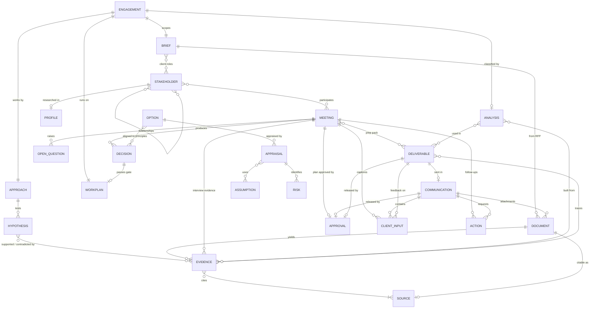

# Horus Project-State Schema and Backend

| | |
|---|---|
| **Version** | 0.3 — implemented in `backend/src/horus_state` (pydantic models export the JSON Schema with `horus schema export`); scheduling block, `meeting_scheduling` action class, `created_in_phase` envelope field |
| **Date** | 25 October 2026 |
| **Status** | Design only. Field definitions here become pydantic models and JSON Schemas in `backend/` once approved. |
| **Companions** | [ARCHITECTURE.md](ARCHITECTURE.md) · [BENCHMARKS.md](BENCHMARKS.md) |

## 0. Purpose and principles

The engagement state is the permanent memory of a Horus engagement. It must let the Principal resume after weeks away, let every claim in a deliverable be traced to graded sources, keep every decision, client comment and open question on the record, and let the backend compute whether a phase gate is ready.

Design rules:

1. **Typed records, one file each.** Every record is a YAML document validated against a JSON Schema. Humans can read and edit it; git can diff it; parallel writers never collide on the same file.
2. **Provenance everywhere.** Every record carries who created it (Principal, which worker run, or a human), when, and in which session. Evidence carries sources; assessments carry assumptions; decisions carry forums.
3. **Links are typed and checked.** Records refer to each other by ID. The server rejects dangling references and relations that do not make sense between two collections.
4. **Append, do not overwrite history.** The event log is append-only. Singletons (brief, approach, workplan) keep version snapshots. Deliverables keep every version.
5. **Rules are mechanical.** The two-source rule, QA before send, decision before gate, approval before outbound: enforced at write time where possible, otherwise reported by `validate`.
6. **The schema is the contract.** The plugin, the CLI, the meeting runtime and any future portal all speak the published JSON Schema; nothing else is assumed.
7. **Supervision is recorded.** Approvals, interventions and autonomy settings are records, so an engagement in shadow mode leaves the same audit trail as a closely supervised one.

## 1. Storage model

```
<engagement>/.horus/
├── engagement.yaml            # singleton
├── brief.yaml                 # singleton, versioned
├── approach.yaml              # singleton, versioned
├── workplan.yaml              # singleton, versioned
├── history/                   # brief.v1.yaml, approach.v2.yaml … snapshots at each approved version
├── stakeholders/  STK-001.yaml …
├── profiles/      PRF-001.yaml …        (confidentiality fixed to sensitive-personal)
├── sources/       SRC-0001.yaml …
├── evidence/      EVD-0001.yaml …
├── documents/     DOC-001.yaml …
├── hypotheses/    HYP-01.yaml …
├── analyses/      ANA-001.yaml + ANA-001.md (narrative) …
├── options/       OPT-A.yaml …
├── appraisals/    APL-001.yaml …
├── assumptions/   ASM-001.yaml …
├── risks/         RSK-001.yaml …
├── meetings/      MTG-001.yaml …
├── client_inputs/ CIN-001.yaml …
├── decisions/     DEC-001.yaml …
├── open_questions/ OQ-001.yaml …
├── actions/       ACT-001.yaml …
├── communications/ COM-001.yaml …
├── deliverables/  DEL-001.yaml …
├── events.jsonl               # append-only audit log and checkpoints
├── approvals/     APV-001.yaml …        (consulted by the outbound guard and by horus-meet before joining)
├── schema.lock                # schema version this state was written with
└── .index.sqlite              # derived full-text and relational index; rebuildable; not versioned
```

Formats and why:

| Content | Format | Reason |
|---|---|---|
| Records | YAML, one file per record | Human-readable, editable, diffable; atomic per-record writes (temp file then rename) |
| Event log | JSON Lines, append-only | Cheap append under a lock; never rewritten |
| Narrative companions (analysis memos, meeting notes) | Markdown next to the record | Long prose does not belong in YAML; the record holds the path |
| Index | SQLite (FTS5 and relational tables) | Fast search and joins for views; rebuilt from files whenever missing or stale |
| Binary artefacts (decks, PDFs, snapshots, models) | Files in the workspace outside `.horus/` | State holds paths and hashes, not blobs |

Companion folders in the workspace: `inbox/` (immutable received files), `library/` (source snapshots named by SRC ID), `analysis/` (memos, data, models, charts), `deliverables/` (rendered files named `<DEL-ID>_v<N>_<slug>.<ext>`), `meetings/<MTG-ID>/` (plan, transcript, recording until deleted, debrief).

## 2. Conventions

### 2.1 Identifiers

`<PREFIX>-<NNN>` with per-engagement counters held in `engagement.yaml`. Prefixes:

| Prefix | Collection | Prefix | Collection |
|---|---|---|---|
| ENG | engagement | OPT | options (letters: OPT-A, OPT-B; variants OPT-A1) |
| STK | stakeholders | APL | appraisals |
| PRF | profiles | ASM | assumptions |
| SRC | sources | RSK | risks |
| EVD | evidence | MTG | meetings |
| DOC | documents | CIN | client_inputs |
| HYP | hypotheses | DEC | decisions |
| ANA | analyses | OQ | open_questions |
| ACT | actions | COM | communications |
| DEL | deliverables | APV | approvals |
| EVT | events (timestamp-based) | | |

Sub-identifiers inside singletons: objectives `OBJ-1`, workstreams `WS-1`, research questions `RQ-01`, workplan activities `A-01`, milestones `M-01`, gates `AP0`–`AP5`.

### 2.2 Common envelope

Every record in every collection carries these fields:

| Field | Type | Required | Notes |
|---|---|---|---|
| `id` | string | yes | Per §2.1; immutable |
| `collection` | enum | yes | Name of the collection; lets a file be understood out of context |
| `created_at`, `updated_at` | ISO 8601 datetime | yes | Set by the server |
| `created_by`, `updated_by` | actor string | yes | `principal`, `researcher:<run>`, `analyst:<run>`, `producer:<run>`, `interviewer:<run>`, `supervisor:<name>`, `meet` (the meeting runtime), `system` |
| `session_id` | string | yes | Claude Code session that wrote the record |
| `status` | enum | yes | Collection-specific lifecycle; defaults listed per collection |
| `confidentiality` | enum | yes | `public`, `client-confidential` (default), `sensitive-personal` |
| `created_in_phase` | enum | no | Phase in which the record was created (P0–P5) |
| `tags` | string[] | no | Free tags for filtering |
| `links` | {rel, to}[] | no | Typed references beyond the record's own fields, for example `{rel: supports, to: HYP-03}` |
| `notes` | string | no | Free text |
| `schema_version` | string | yes | Set by the server |

Reference fields in the tables below (written `→ STK`) hold an ID string or a list of ID strings of the named collection.

### 2.3 Values and dates

Numbers carry a unit and a reference period; money carries currency and price-base year. Dates are ISO 8601. Geography uses ISO 3166 country codes with an optional subnational label. Confidence is `low`, `medium` or `high` wherever a judgement is recorded.

## 3. Collections

Grouped as: A. Scope and plan · B. People and politics · C. Knowledge · D. Analysis · E. Engagement loop · F. Outputs · G. System. Envelope fields from §2.2 are not repeated.

### A. Scope and plan

#### A1. `engagement` (singleton)

| Field | Type | Required | Notes |
|---|---|---|---|
| `code` | string | yes | Human slug used for the folder, for example `EGY-2026-003-sme-digital` |
| `name` | string | yes | |
| `client` | object | yes | `entity`, `acronym`, `country` (ISO), `level` (`national`, `subnational`, `supranational`), `sector` |
| `policy_domain` | string[] | yes | |
| `pathway` | object | yes from AP0 | `{primary (enum §4), secondary[], rationale, classified_in: → ANA, confirmed_in: → DEC, revisions[] {date, from, to, decision: → DEC}}` |
| `languages` | string[] | yes | Working, deliverable and meeting languages |
| `currency`, `price_base_year`, `fiscal_year_start` | string, int, string | yes | Defaults for the toolkit |
| `status` | enum | yes | `active`, `paused`, `closed` |
| `phase` | enum | yes | `P0`…`P5`, `closed` |
| `gates` | map AP → object | yes | `{status: not_ready\|ready\|passed, passed_in: → DEC, passed_at}` for AP0–AP5 |
| `dates` | object | yes | `received`, `started`, `target_end`, `closed` |
| `team` | object | yes | `supervisors[]`, `principal_model`, `worker_models {researcher, researcher_profiles, analyst, producer, interviewer_live, interviewer_debrief}` |
| `settings.autonomy` | object | yes | `profile: default\|shadow\|custom` and a map of action class (§4) → level `auto\|notify\|approve\|human`; the guard, `horus-meet` and the Principal read it |
| `settings.meetings` | object | yes | `default_language`, `disclosure_jurisdiction`, `recording_retention: delete_after_verification\|retain_days:<n>\|retain`, `off_record_handling: remove\|flag`, `providers {bot, stt, tts}`, `latency_target_ms`, `max_duration_min` |
| `settings.evidence` | object | yes | `grade_floor` (default `B`), `two_source_rule` (default true) |
| `settings.research_budget` | object | yes | `per_phase: {runs, fetches}` |
| `settings.default_discount_rate` | → ASM | no | |
| `counters` | map prefix → int | yes | ID counters |
| `last_checkpoint` | → EVT | no | |
| `workspace` | object | yes | Relative paths of `inbox`, `library`, `analysis`, `deliverables`, `meetings` |

#### A2. `brief` (singleton, versioned)

| Field | Type | Required | Notes |
|---|---|---|---|
| `version` | int | yes | Snapshot to `history/` on each status change to `confirmed` or `amended` |
| `status` | enum | yes | `draft`, `clarifying`, `confirmed`, `amended` |
| `rfp_documents` | → DOC[] | yes | The RFP or terms of reference and attachments |
| `issued_by` | → STK | yes | Client organisation |
| `received_on` | date | yes | |
| `title` | string | yes | |
| `context_summary` | string | yes | |
| `problem_statement` | object | yes | `as_given`, `as_reframed`, `reframing_rationale` |
| `objectives` | object[] | yes | `{id: OBJ-n, statement, measurable: bool, indicator}` |
| `scope_in`, `scope_out` | string[] | yes | |
| `required_deliverables` | object[] | yes | `{id, description, format, due, maps_to: → DEL}` |
| `timeline` | object | yes | `start`, `end`, `milestones[] {name, date}` |
| `constraints` | object[] | no | `{kind: budget\|legal\|political\|data\|timing\|other, statement}` |
| `evaluation_criteria` | string[] | no | How the client will judge the work |
| `client_roles` | object | yes | `pm → STK`, `sponsor → STK`, `ultimate_decision_maker → STK`, `steering → STK[]` |
| `assumptions` | string[] | no | Horus assumptions about the mandate |
| `clarifications` | object[] | no | `{question: → OQ, answer, answered_in: → COM or MTG}` |
| `success_criteria` | string[] | no | |
| `confirmed_in` | → DEC | no | The decision of kind `scope` that closes AP0 |

#### A3. `approach` (singleton, versioned)

| Field | Type | Required | Notes |
|---|---|---|---|
| `version`, `status` | int, enum | yes | `draft`, `proposed`, `approved`, `revised` |
| `problem_framing` | → ANA | yes | The issue tree analysis |
| `methodology_narrative` | string | yes | The approach as it appears in the kickoff deck |
| `frameworks` | object[] | yes | `{id (catalogue id), name, source_org, rationale, used_in_phases[]}` |
| `workstreams` | object[] | yes | `{id: WS-n, name, objective, key_questions: RQ ids, outputs[]}` |
| `analytical_plan` | object | yes | `research_questions[] {id: RQ-nn, question, hypotheses: → HYP[], method, data_sources[], workstream, status: planned\|running\|done\|dropped, memo: → ANA, runs[] (worker run ids)}` |
| `engagement_plan_summary` | object | yes | `interview_targets: → STK[]`, `workshops[]`, `cadence` |
| `quality_plan` | object | yes | `grade_floor`, `review_policy`, `traceability_required: bool` |
| `governance` | object | yes | `steering_members: → STK[]`, `pm_cadence`, `decision_forums[]` |
| `approved_in` | → DEC | no | |

#### A4. `workplan` (singleton, versioned)

| Field | Type | Required | Notes |
|---|---|---|---|
| `version`, `status` | int, enum | yes | `draft`, `proposed`, `approved`, `revised` |
| `phases` | object[] | yes | `{id: P0…P5, name, start, end, gate: AP id, status: planned\|active\|done}` |
| `activities` | object[] | yes | `{id: A-nn, phase, workstream, name, owner: principal\|supervisor\|client, start, end, depends_on[], status: planned\|in_progress\|done\|blocked\|dropped, outputs: → DEL or ANA[], pct_complete}` |
| `milestones` | object[] | yes | `{id: M-nn, name, date, kind: gate\|deliverable\|meeting\|client_input, status, linked: → MTG or DEL}` |
| `gates` | object[] | yes | `{id: AP0…AP5, name, criteria[] {rule_id, description, satisfied: bool (computed), evidence}, decisions_required: kinds[], status, passed_in: → DEC}` |
| `cadence` | object | yes | `pm_checkin`, `steering`, `status_note` |
| `change_log` | object[] | no | `{date, change, reason, approved_in: → DEC or CIN}` |

### B. People and politics

#### B1. `stakeholders`

One record per person, organisation, group or public segment that matters to the decision.

| Field | Type | Required | Notes |
|---|---|---|---|
| `name` | string | yes | |
| `kind` | enum | yes | `person`, `organisation`, `group`, `public_segment` |
| `organisation` | → STK | no | For persons: their organisation record |
| `title` | string | no | Current role title |
| `category` | enum | yes | See §4 (client roles, government, legislature, regulator, industry, civil society, academia, media, international, public) |
| `jurisdiction` | string | no | |
| `is_client` | bool | yes | |
| `client_role` | enum | no | `pm`, `sponsor`, `ultimate_decision_maker`, `steering`, `working_level`, `none` |
| `decision_role` | enum | yes | RAPID: `recommend`, `agree`, `perform`, `input`, `decide`, `none` |
| `influence`, `interest` | int 1–5 | yes | Mendelow axes; `unknown` allowed via null with note |
| `stance` | enum | yes | `champion`, `supportive`, `neutral`, `sceptical`, `opposed`, `unknown` |
| `stance_confidence` | enum | yes if stance known | `low`, `medium`, `high` |
| `stance_basis` | → EVD[] | yes if stance known | |
| `interests`, `concerns`, `red_lines` | string[] | no | |
| `public_positions` | → EVD[] | no | Statements on the issue |
| `predicted_reactions` | object[] | no | `{target: → OPT or DEC (principle), reaction: support\|conditional\|neutral\|resist\|block, rationale, confidence, basis: → EVD[]}` |
| `relationships` | object[] | no | `{to: → STK, type: reports_to\|oversees\|allied_with\|rival_of\|influences\|funds\|regulates\|member_of\|advises, strength: weak\|moderate\|strong, basis: observed\|assessed, evidence: → EVD[]}` |
| `engagement` | object | yes | `{priority: 1\|2\|3\|none, purpose, format: interview\|workshop\|briefing\|consultation\|none, owner, status: not_planned\|requested\|scheduled\|engaged\|declined, meetings: → MTG[], next_step}` |
| `profile` | → PRF | no | |
| `sources` | → SRC[] | no | |
| `last_reviewed` | date | yes | Stance and predictions go stale |

Example:

```yaml
id: STK-004
collection: stakeholders
name: Deputy Minister for Digital Transformation
kind: person
organisation: STK-002
category: client_internal
is_client: true
client_role: steering
decision_role: agree
influence: 4
interest: 5
stance: supportive
stance_confidence: medium
stance_basis: [EVD-0031, EVD-0047]
red_lines: ["No new licensing regime for small merchants"]
predicted_reactions:
  - {target: OPT-B, reaction: conditional, rationale: "Supports mandate if phased for micro-firms", confidence: medium, basis: [EVD-0047]}
relationships:
  - {to: STK-003, type: reports_to, strength: strong, basis: observed, evidence: [EVD-0012]}
  - {to: STK-009, type: rival_of, strength: moderate, basis: assessed, evidence: [EVD-0052]}
engagement: {priority: 1, purpose: "Validate baseline and test phasing", format: interview, owner: supervisor, status: scheduled, meetings: [MTG-007]}
profile: PRF-003
confidentiality: client-confidential
last_reviewed: 2026-11-04
```

#### B2. `profiles` (confidentiality fixed to `sensitive-personal`)

Deep research on a person or organisation. Never copied into client-facing material; the Principal distils implications into `analyses` instead.

| Field | Type | Required | Notes |
|---|---|---|---|
| `subject` | → STK | yes | |
| `scope` | enum | yes | `person`, `organisation` |
| `summary` | string | yes | Five lines, factual |
| `career` | object[] | person | `{from, to, role, organisation, source: → SRC}` |
| `education` | object[] | no | |
| `affiliations` | object | no | `party`, `declared_positions[]`, `networks[]` |
| `orientation_assessment` | object | no | Per axis (`economic`, `social`, `governance_style`, `reform_appetite`): `{assessment, confidence, basis: → EVD[]}`; always labelled assessed |
| `priorities_stated` | object[] | no | `{theme, statement: → EVD, date}` |
| `track_record` | object[] | no | `{decision, date, outcome, source: → SRC}` |
| `positions_on_topic` | object[] | no | `{topic, position, date, evidence: → EVD}` |
| `communication_style` | string | no | Observed, with examples |
| `advisers_and_networks` | → STK[] | no | |
| `political_calendar` | object[] | no | `{event, date, relevance}` |
| `online_presence` | object[] | no | `{platform, handle, url, official: bool}` |
| `controversies_public` | object[] | no | Public record only: `{summary, source: → SRC}` |
| `structure` | object | organisation | `units[] {name, head: → STK, mandate}`, `headcount`, `budget` (if public) |
| `factions_assessed` | object[] | organisation | `{name, members: → STK[], position, confidence, basis: → EVD[]}` |
| `implications_for_engagement` | string[] | yes | What this means for framing, options and sequencing |
| `overall_confidence` | enum | yes | |
| `review` | object | yes | `{personal_data_minimised: bool, defamation_check: bool, reviewed_by, date}` |
| `sources` | → SRC[] | yes | |

### C. Knowledge

#### C1. `sources`

One record per document, dataset, page, interview or data pull that evidence can cite.

| Field | Type | Required | Notes |
|---|---|---|---|
| `title` | string | yes | |
| `type` | enum | yes | `peer_reviewed`, `official_statistics`, `legal_text`, `government_document`, `io_report` (World Bank, IMF, OECD and similar), `think_tank_report`, `consultancy_report`, `poll`, `dataset`, `news`, `trade_press`, `advocacy`, `company`, `encyclopaedic`, `social_media`, `speech_or_statement`, `parliamentary_record`, `interview`, `client_document`, `other` |
| `publisher`, `authors` | string, string[] | yes, no | |
| `publication_date` | date | yes if known | |
| `url`, `doi`, `isbn` | string | one of | |
| `citation` | string | yes | Formatted citation used in footnotes and bibliography |
| `tier` | enum | yes | `A`, `B`, `C`, `D`, `E` per ARCHITECTURE.md §8 |
| `tier_rationale` | string | yes | Why this tier |
| `independence_group` | string | yes | Sources that derive from the same primary share a group; the two-source rule counts distinct groups |
| `interest_declared` | enum | yes | `none`, `commercial`, `advocacy`, `government`, `party` |
| `access` | object | yes | `{retrieved_at, retrieved_by, snapshot_path, hash, paywalled: bool, query (for data pulls)}` |
| `language`, `geography` | string | no | |
| `status` | enum | yes | `active`, `superseded`, `retracted`, `unreachable` |

#### C2. `evidence`

One atomic claim per record: a fact, number, quote, legal provision or finding, with the sources that support it.

| Field | Type | Required | Notes |
|---|---|---|---|
| `statement` | string | yes | One claim, in Horus's words |
| `kind` | enum | yes | `fact`, `statistic`, `estimate`, `quote`, `finding`, `legal_provision`, `event`, `position`, `forecast` |
| `value` | object | if numeric | `{number, unit, period, geography, as_of, currency, price_base_year}` |
| `quote_text` | string | if quote | Verbatim, with speaker → STK |
| `sources` | → SRC[] | yes, at least 1 | |
| `corroboration` | enum | yes | `single_source`, `corroborated`, `contested`, `refuted` |
| `independence_count` | int | computed | Distinct `independence_group`s across sources |
| `grade` | enum | computed | Best tier among sources |
| `validated` | bool | computed | True if one Tier-A source, or at least two independent sources of Tier B or better, and not `contested` or `refuted` |
| `confidence` | enum | yes | |
| `attribution` | enum | if from interview | `on_record`, `background`, `not_for_attribution` |
| `research_question` | RQ id | no | |
| `supports`, `contradicts` | → HYP[] | no | |
| `about` | → STK or OPT[] | no | Who or what the claim concerns |
| `used_in` | → DEL or ANA[] | computed | Filled from storyboards and analyses |
| `status` | enum | yes | `active`, `superseded`, `withdrawn` |

Example:

```yaml
id: EVD-0047
collection: evidence
statement: "Only 18% of registered micro-enterprises issued an electronic invoice in 2025."
kind: statistic
value: {number: 18, unit: percent, period: "2025", geography: EGY, as_of: 2026-03-31}
sources: [SRC-0022, SRC-0031]
corroboration: corroborated
independence_count: 2
grade: A
validated: true
confidence: high
research_question: RQ-03
supports: [HYP-02]
about: [OPT-B]
created_by: researcher:r-2026-11-02-03
```

#### C3. `documents`

Files received or collected: the RFP, client documents, legislation, reports, transcripts. The file itself is immutable under `inbox/` or `library/`.

| Field | Type | Required | Notes |
|---|---|---|---|
| `title` | string | yes | |
| `kind` | enum | yes | `rfp`, `terms_of_reference`, `contract`, `client_data`, `client_report`, `legislation`, `regulation`, `strategy`, `budget`, `statistics`, `academic`, `report`, `news`, `transcript`, `minutes`, `presentation`, `other` |
| `origin` | enum | yes | `client`, `public`, `stakeholder`, `horus` |
| `received_via` | → COM or MTG | no | |
| `received_on`, `document_date` | date | yes, no | |
| `issuer` | string | no | |
| `path`, `hash`, `pages`, `language` | string, string, int, string | yes, yes, no, no | |
| `summary` | string | yes once processed | |
| `key_points` | → EVD[] | no | Evidence extracted from the document |
| `source` | → SRC | if public | The citable source record |
| `processing` | object | yes | `{status: received\|extracted\|summarised\|mined, by, at}` |
| `related` | → OPT, MTG or brief sections[] | no | |

#### C4. `hypotheses`

The hypothesis tree the Principal tests; the backbone of hypothesis-driven work.

| Field | Type | Required | Notes |
|---|---|---|---|
| `statement` | string | yes | Falsifiable |
| `kind` | enum | yes | `diagnostic`, `causal`, `option_effect`, `political`, `stakeholder`, `implementation` |
| `parent` | → HYP | no | Position in the issue tree |
| `research_questions` | RQ ids | no | |
| `status` | enum | yes | `untested`, `testing`, `supported`, `refuted`, `revised`, `dropped` |
| `confidence` | enum | yes | |
| `evidence_for`, `evidence_against` | → EVD[] | no | |
| `revision_history` | object[] | no | `{date, from, to, reason}` |
| `implications` | string | no | What changes if true or false |

### D. Analysis

#### D1. `analyses`

Structured analytical outputs. One collection with a `kind` field avoids a collection per analysis type while keeping each kind's content schema explicit.

| Field | Type | Required | Notes |
|---|---|---|---|
| `kind` | enum | yes | `problem_classification`, `problem_framing`, `issue_tree`, `baseline`, `diagnostic`, `strategic_position`, `institutional_diagnostic`, `delivery_chain`, `strategic_case`, `user_and_service_research`, `benchmark`, `scenario_analysis`, `public_sentiment`, `internal_politics`, `decision_maker_lens`, `stakeholder_reaction_matrix`, `options_screening`, `option_comparison`, `implementation_plan`, `communication_plan`, `research_memo`, `interview_debrief`, `other` |
| `title`, `question` | string | yes | |
| `frameworks` | catalogue ids[] | no | |
| `inputs` | → EVD, SRC, MTG, ANA, DOC[] | yes | |
| `method_notes` | string | yes | |
| `content` | object | yes | Kind-specific structure validated by a per-kind sub-schema (examples below) |
| `narrative_path` | path | no | Markdown companion |
| `findings` | object[] | yes | `{statement, evidence: → EVD[], confidence}` |
| `limitations` | string[] | yes | |
| `version` | int | yes | |
| `status` | enum | yes | `draft`, `reviewed`, `final`, `superseded` |
| `used_in` | → DEL[] | computed | |

Kind-specific `content` shapes (initial set):

- `problem_classification`: `signals[] {question, answer, evidence: → DOC or EVD}`, `candidates[] {pathway, fit 1–5, rationale}`, `primary`, `secondary[]`, `hybrid_notes`, `revisit_triggers[]`.
- `research_memo`: `question`, `brief_ref`, `findings_ranked[] {statement, evidence: → EVD[], confidence}`, `gaps[]`, `follow_ups[]`, `ids_written {sources[], evidence[]}`, `fetches_used`, `budget`.

- `stakeholder_reaction_matrix`: `rows: → STK[]`, `columns: → OPT or DEC[]`, `cells[] {stakeholder, target, reaction, rationale, confidence, basis: → EVD[]}`, `coalition_notes`.
- `public_sentiment`: `topic`, `population`, `period`, `themes[] {theme, salience 1–5, direction, intensity, segments[], illustrative: → EVD[]}`, `polls: → EVD[]`, `media {volume_trend, tone}`, `search_interest`, `caveats[]`.
- `benchmark`: `comparators[] {country, why_chosen}`, `dimensions[]`, `table[] {comparator, dimension, value: → EVD}`, `lessons[]`.
- `decision_maker_lens`: `subject: → STK`, `priorities[]`, `red_lines[]`, `decision_style`, `calendar[]`, `framing_guidance[]`, `profile: → PRF`.
- `internal_politics`: `entity: → STK`, `units[]`, `positions_by_option[] {unit or person: → STK, option: → OPT, position, rationale, confidence}`, `influence_paths[]`, `watch_points[]`.
- `options_screening`: `criteria[] {criterion, weight, source: → DEC}`, `scores[] {option: → OPT, criterion, score, rationale}`, `shortlist: → OPT[]`.
- `option_comparison`: `options: → OPT[]`, `assessments: → APL[]`, `criteria_weights: → DEC`, `table`, `ranking[]`, `recommendation_candidates: → OPT[]`.
- `implementation_plan`: `workstreams[]`, `sequencing[] {phase, actions[], owners: → STK[], dates}`, `instruments_required[] {instrument, type: law|decree|regulation|circular|budget|MoU, owner}`, `institutional_arrangements`, `budget {capex, opex, source}`, `capacity_needs[]`, `kpis[] {name, baseline, target, source, frequency}`, `delivery_chain[]`, `risks: → RSK[]`.
- `communication_plan`: `narrative`, `message_house {core, pillars[], proofs: → EVD[]}`, `audiences[] {stakeholder or segment: → STK, objective, messages[], channels[], timing, spokesperson, risks}`, `sequencing[]`, `qa_bank[] {question, answer, evidence: → EVD[]}`, `opposition_handling[]`.

#### D2. `options`

Options of whatever kind the pathway produces: regulatory instruments, strategic choices, operating-model archetypes, delivery interventions, investment options, service concepts, and packages of them.

| Field | Type | Required | Notes |
|---|---|---|---|
| `code` | string | yes | `A`, `B`, `C`…; variants `A1`, `A2`; packages `P1` |
| `title`, `summary` | string | yes | |
| `kind` | enum | yes | `regulatory_instrument`, `strategic_choice`, `operating_model`, `delivery_intervention`, `investment_option`, `service_concept`, `package`, `do_nothing` |
| `addresses_objectives` | OBJ ids | yes | |
| `instrument_types` | enum[] | regulatory kinds | `regulation`, `economic_incentive`, `tax_or_fee`, `subsidy_or_grant`, `information_or_disclosure`, `direct_provision`, `organisational_or_institutional`, `co_regulation`, `voluntary_or_standard`, `behavioural_nudge`, `procurement` |
| `mechanism` | object | yes | Theory of change: `inputs`, `activities`, `outputs`, `outcomes`, `impacts`, `key_assumptions: → ASM[]` |
| `design_parameters` | object[] | no | `{lever, setting, alternatives[]}` |
| `variants` | object[] | no | `{id, description}` |
| `target_groups` | string[] | yes | |
| `precedents` | object[] | no | `{jurisdiction, programme, period, outcome, evidence: → EVD[]}` |
| `origin` | enum | yes | `horus`, `client`, `stakeholder`, `literature` |
| `status` | enum | yes | `long_list`, `screened_out`, `short_list`, `appraised`, `preferred`, `recommended`, `rejected`, `merged` |
| `screening` | object | no | `{criteria[] {criterion, score, rationale}, result, rationale, analysis: → ANA}` |
| `principles_alignment` | object[] | no | `{principle: → DEC, score −2…+2, rationale}` |
| `reactions` | → ANA | no | The reaction-matrix analysis |
| `appraisal` | → APL | no | Current appraisal |
| `risks` | → RSK[] | no | |
| `package_members` | → OPT[] | if package | |

#### D3. `appraisals`

One record per option (or package) and version, in the method the pathway pack prescribes. The common blocks are always present; the method-specific blocks are required by `kind`.

| Field | Type | Required | Notes |
|---|---|---|---|
| `options` | → OPT[] | yes | |
| `version` | int | yes | |
| `kind` | enum | yes | `ria`, `strategic_options`, `operating_model`, `delivery_intervention`, `business_case`, `service_concept`, `other` |
| `pathway` | enum | yes | The pathway whose pack defined the method |
| `baseline` | object | yes | `{description, analysis: → ANA}` — the do-nothing or business-as-usual counterfactual |
| `standards_applied` | string[] | yes | For example `OECD-RIA-2020`, `EU-BR-Toolbox-2025`, `HMT-Green-Book-2026`, `OMB-A4-2023` (method), `Five-Case-Model` |
| `methodology` | enum | yes | `cba`, `cea`, `mca`, `scm`, `qualitative`, `mixed` |
| `proportionality_level` | enum | yes | `light`, `standard`, `full` |
| `time_horizon` | object | yes | `{start_year, years}` |
| `discount_rate` | → ASM | if monetised | |
| `impacts` | object[] | yes | `{dimension (enum §4), direction: positive\|negative\|mixed\|neutral, quantified: bool, estimate {central, low, high, unit, present_value: bool}, rating −3…+3 (if qualitative), affected_groups[], assumptions: → ASM[], evidence: → EVD[], method, confidence, notes}` |
| `summary` | object | yes | `{npv {central, low, high}, bcr, net_benefit, mca_score, rank, verdict}` as applicable |
| `distributional` | object | yes | `{groups[], incidence[], equity_note}` |
| `feasibility` | object | yes | `{administrative, legal, political}` each `{rating 1–5, note, evidence: → EVD[]}` |
| `sensitivity` | object | yes if quantified | `{method: scenarios\|monte_carlo\|switching_values, parameters: → ASM[], results_path, robustness: robust\|sensitive_to[]\|fragile}` |
| `risks` | → RSK[] | yes | |
| `monitoring` | object | yes | `{indicators[] {name, baseline, target, source, frequency, owner}, evaluation {when, method}}` |
| `regulatory` | object | kind `ria` | `{sme_test {applicable, finding, evidence}, competition_check {applicable, finding, evidence}, compliance_cost_scm, enforcement_strategy, review_clause}` |
| `strategic` | object | kind `strategic_options` | `{criteria_weights: → DEC, scenario_results[] {scenario, performance}, order_of_magnitude_cost}` |
| `operating_model` | object | kind `operating_model` | `{fit_to_mandate, capability_gap, transition_risk, legal_changes_required[], cost_delta}` |
| `delivery` | object | kind `delivery_intervention` | `{trajectory {baseline_series, target_series, intervention_series}, bottlenecks_addressed[], effort, dependencies[]}` |
| `five_case` | object | kind `business_case` | `{strategic, economic (appraisal summary table path), commercial, financial (affordability), management}` each with `status` and `summary`; `optimism_bias_uplift` |
| `service` | object | kind `service_concept` | `{outcomes[], take_up_estimate, cost_per_outcome, equity_assessment, pilot_design {design, sample, duration, evaluation_method}}` |
| `artefacts` | object[] | yes if quantified | `{path, kind: model\|data\|chart\|notebook\|report, inputs_hash}` |
| `caveats` | string[] | yes | |
| `reviewed_by` | actor | no | |
| `status` | enum | yes | `draft`, `reviewed`, `final`, `superseded` |

#### D4. `assumptions`

The register every model draws from, so a discount rate or population figure is set once and traced everywhere.

| Field | Type | Required | Notes |
|---|---|---|---|
| `name` | string | yes | |
| `category` | enum | yes | `macro`, `demographic`, `cost`, `behavioural`, `policy`, `technical`, `financial` |
| `value`, `unit` | number, string | yes | |
| `low`, `high` | number | no | Range for sensitivity |
| `distribution` | enum | no | `point`, `uniform`, `triangular`, `normal`, `lognormal` |
| `basis` | enum | yes | `evidence`, `expert_judgement`, `client`, `convention` |
| `evidence` | → EVD[] | if basis is evidence | |
| `source_note` | string | yes | |
| `used_in` | → APL or ANA[] | computed | |
| `sensitivity_rank` | enum | no | `high`, `medium`, `low` after sensitivity runs |
| `owner` | actor | yes | |
| `status` | enum | yes | `proposed`, `agreed`, `superseded` |
| `agreed_in` | → DEC or CIN | no | |

#### D5. `risks`

Engagement-delivery risks and policy or implementation risks in one register, separated by `scope`.

| Field | Type | Required | Notes |
|---|---|---|---|
| `scope` | enum | yes | `engagement`, `policy_outcome`, `implementation`, `political`, `reputational`, `legal`, `fiscal` |
| `description`, `cause`, `consequence` | string | yes | |
| `likelihood`, `impact` | int 1–5 | yes | `score` computed as the product |
| `mitigation`, `contingency` | string | yes, no | |
| `owner` | actor or → STK | yes | |
| `early_warning` | string | no | |
| `linked` | → OPT, APL, DEL or workplan activity[] | no | |
| `status` | enum | yes | `open`, `mitigating`, `closed`, `materialised` |
| `source` | → EVD or MTG | no | |

### E. Engagement loop

#### E1. `meetings` (includes interview records and live-meeting state)

Every client or stakeholder touchpoint: kickoff, PM check-ins, steering sessions, interviews, workshops, readouts, the final presentation. Interviews are meetings of kind `interview` with the mandatory `interview_record` block. Live meetings conducted or attended by Horus carry the `plan`, `bot`, `disclosure`, `consent`, `live` and `transcript` blocks written by `horus-meet` and the `interviewer`.

| Field | Type | Required | Notes |
|---|---|---|---|
| `kind` | enum | yes | `kickoff`, `pm_checkin`, `steering`, `interview`, `workshop`, `readout`, `final_presentation`, `internal` |
| `title` | string | yes | |
| `status` | enum | yes | `proposed`, `requested`, `scheduled`, `joining`, `in_progress`, `held`, `cancelled`, `no_show`, `aborted` |
| `conduct_mode` | enum | yes | `interviewer` (Horus conducts through the worker), `principal_co_led` (Supervisor presents, Horus attends and captures), `human` (Horus prepares and captures from notes) |
| `requested_via` | → ACT or COM | no | |
| `join_url`, `platform` | string, enum | for live meetings | `zoom`, `meet`, `teams`, `other`; the link arrives by email and is attached at triage |
| `scheduled_at`, `held_at` | datetime | no | |
| `duration_min`, `time_budget_min` | int | no | Actual and planned |
| `mode`, `location` | enum, string | no | `virtual`, `in_person`, `phone` |
| `participants` | object[] | yes | `{stakeholder: → STK, role: client\|stakeholder\|horus\|supervisor\|observer, attended: bool, speaker_label}` — `speaker_label` maps diarised speakers to stakeholders |
| `purpose`, `objectives` | string, string[] | yes | |
| `decisions_sought` | object[] | no | `{statement, outcome: → DEC}` |
| `hypotheses_to_test` | → HYP[] | no | |
| `open_questions_to_close` | → OQ[] | no | |
| `plan` | object | required for `interviewer` and `principal_co_led` | `{path, version, question_guide[] {id, question, priority 1–3, purpose, tests: → HYP or OQ, follow_up_heuristics[], asked: bool, answer_summary, turns[]}, follow_up_rules[], sensitivities[], do_not_say[], disclosure_script_id, consent_terms, attribution_rule, escalation_rules[], approval: → APV}` |
| `agenda` | object[] | no | `{item, minutes, lead, deliverable: → DEL}` |
| `prep_pack` | → DEL[] | yes for client meetings | |
| `pre_read_sent` | → COM | no | |
| `scheduling` | object | yes | `{status: not_started\|slots_proposed\|awaiting_reply\|confirmed\|rescheduling\|cancelled, proposed_slots[] {start, end, timezone, status}, selected_slot, request_sent: → COM, reply_received: → COM, invite_document: → DOC, calendar_event_id, organiser: horus\|client\|stakeholder, approval: → APV}` |
| `bot` | object | live | `{provider, bot_id, display_name, requested_at, joined_at, admitted_at, left_at, exit_reason}` |
| `disclosure` | object | live | `{script_id, spoken_at, chat_posted_at, text}` |
| `consent` | object | live | `{ai_participant: bool, recording: bool, transcript: bool, attribution_rule: on_record\|background\|not_for_attribution, given_by: → STK, given_at, objections[] {at, text, response}, withdrawn_at, off_record_segments[] {from, to}}` |
| `live` | object | live | `{coverage {asked, total, skipped[]}, supervisor_interventions[] {type: whisper\|pause\|resume\|takeover\|leave, at, text, by}, marks[] {label, at}, fallbacks[] {type, at, outcome}, latency {median_ms, p95_ms}}` |
| `transcript` | object | live | `{path, language, diarised: bool, provider, turns, verified_by, verified_at, retention_until, off_record_removed: bool}` |
| `recording` | object | live | `{path, retention_until, deleted_at}` |
| `notes` | object | after held | `{raw_path, structured {key_points[], positions: → EVD[], quotes: → EVD[], surprises[], sentiment}}` |
| `interview_record` | object | required when an interview is `held` | `{topics[] {topic, position, evidence: → EVD}, reaction_to_options[] {option: → OPT, reaction, evidence: → EVD}, contradictions[] {hypothesis: → HYP, note}, documents_promised: → ACT[], documents_shared: → DOC[], directives_received: → CIN[], referrals: → STK[], follow_ups: → ACT[], proposed_updates {stakeholder_patch, hypothesis_patches[], confirmed_by, confirmed_at}}` |
| `outcomes` | object | after held | `{decisions: → DEC[], client_inputs: → CIN[], open_questions: → OQ[], actions: → ACT[], evidence: → EVD[]}` |
| `debrief` | object | after held | `{path, by, what_worked, what_to_change}` |
| `follow_up_sent` | → COM | no | |

#### E2. `client_inputs` (feedback, directives, approvals, documents)

Anything the client says or gives that should change what Horus does.

| Field | Type | Required | Notes |
|---|---|---|---|
| `kind` | enum | yes | `feedback`, `directive`, `guiding_principle_input`, `approval`, `rejection`, `request`, `document_provided`, `data_provided`, `clarification`, `instruction`, `preference` |
| `from` | → STK | yes | |
| `via` | → MTG or COM | yes | |
| `date` | date | yes | |
| `content_verbatim` | string | yes where available | |
| `paraphrase` | string | yes | |
| `about` | object[] | no | `{target: → DEL (with version), OPT, ANA or workplan item, section}` |
| `sentiment` | enum | yes | `positive`, `neutral`, `negative`, `mixed` |
| `priority` | enum | yes | `P1`, `P2`, `P3` |
| `disposition` | enum | yes | `pending`, `accepted`, `partially_accepted`, `declined`, `superseded` |
| `disposition_rationale` | string | required if not pending | |
| `response` | object | no | `{what_changed, deliverable_version: → DEL, decision: → DEC, communicated_in: → COM}` |
| `owner` | actor | yes | |
| `status` | enum | yes | `open`, `addressed`, `closed` |

#### E3. `decisions`

| Field | Type | Required | Notes |
|---|---|---|---|
| `kind` | enum | yes | `scope`, `pathway`, `methodology`, `workplan`, `guiding_principle`, `political_directive`, `shortlist`, `criteria_weights`, `preferred_option`, `recommendation`, `deliverable_approval`, `gate`, `autonomy`, `supervisor_directive`, `process`, `other` |
| `statement` | string | yes | |
| `proposed_by` | enum | yes | `horus`, `client`, `stakeholder`, `supervisor` |
| `made_by` | → STK[] or supervisor | required when confirmed | |
| `forum` | → MTG | one of forum or channel | |
| `channel` | → COM | | |
| `date` | date | yes | |
| `rationale` | string | yes | |
| `alternatives_considered` | string[] | no | |
| `implications` | object[] | no | `{area, change}` |
| `affects` | → OPT, DEL, workplan or approach items[] | no | |
| `gate` | AP id | required if kind is gate | |
| `status` | enum | yes | `proposed`, `confirmed`, `superseded`, `reversed` |
| `supersedes` | → DEC | no | |
| `review_date` | date | no | |

Example:

```yaml
id: DEC-011
collection: decisions
kind: guiding_principle
statement: "Compliance obligations for micro-enterprises are phased over 36 months and paired with free tooling."
proposed_by: horus
made_by: [STK-003, STK-004]
forum: MTG-012
date: 2026-12-09
rationale: "Steering accepted phasing after reaction matrix showed blocking risk from merchant associations."
implications:
  - {area: options, change: "OPT-B variant B2 (phased) replaces B1 in the shortlist"}
  - {area: criteria_weights, change: "SME burden weight raised to 0.25"}
affects: [OPT-B, ANA-014]
status: confirmed
```

#### E4. `open_questions`

| Field | Type | Required | Notes |
|---|---|---|---|
| `question`, `context` | string | yes, no | |
| `kind` | enum | yes | `clarification`, `data`, `analytical`, `political`, `process` |
| `raised_by` | → STK or actor | yes | |
| `raised_in` | → MTG, COM or session id | yes | |
| `date` | date | yes | |
| `owner` | → STK or actor | yes | Who must answer |
| `priority` | enum | yes | `P1`, `P2`, `P3` |
| `blocking` | AP id, → DEL, OPT or APL[] | no | Readiness logic uses this |
| `due` | date | no | |
| `status` | enum | yes | `open`, `awaiting_client`, `answered`, `parked`, `closed` |
| `answer` | string | when answered | |
| `answered_by` | → DEC, CIN, EVD or MTG | when answered | |
| `answered_at` | date | when answered | |

#### E5. `actions` (tasks and requests)

Internal tasks, requests to the client for data, documents, meetings or decisions, and follow-ups. Replaces separate "request" and "task" lists.

| Field | Type | Required | Notes |
|---|---|---|---|
| `kind` | enum | yes | `internal_task`, `client_request_data`, `client_request_document`, `client_request_meeting`, `client_request_decision`, `stakeholder_outreach`, `follow_up`, `approval_needed` |
| `title`, `detail` | string | yes, no | |
| `owner` | actor or → STK | yes | |
| `requested_via` | → COM or MTG | no | |
| `due` | date | no | |
| `priority` | enum | yes | `P1`, `P2`, `P3` |
| `status` | enum | yes | `todo`, `requested`, `in_progress`, `blocked`, `done`, `cancelled`; `overdue` is computed |
| `fulfilled_by` | → DOC, MTG, DEC, CIN or DEL | no | |
| `linked` | AP id, → OQ, DEL or RQ[] | no | |
| `reminders` | object[] | no | `{date, sent_in: → COM}` |

#### E6. `communications` (correspondence log)

| Field | Type | Required | Notes |
|---|---|---|---|
| `channel` | enum | yes | `email`, `message`, `letter`, `portal`, `call_note` |
| `direction` | enum | yes | `inbound`, `outbound` |
| `external_ref` | string | no | Gmail thread or message ID |
| `from` | → STK or actor | yes | |
| `to`, `cc` | → STK or email[] | yes, no | |
| `date` | datetime | yes | |
| `subject`, `summary` | string | yes | |
| `body_path` | path | yes | Archived `.eml` or `.md` under `inbox/` |
| `attachments` | → DOC[] | no | |
| `classification` | enum | yes | `client_pm`, `client_dm`, `stakeholder`, `internal`, `vendor` |
| `extracted` | object | after triage | `{actions: → ACT[], client_inputs: → CIN[], open_questions: → OQ[], decisions: → DEC[], evidence: → EVD[]}` |
| `approval` | → APV | outbound | Required when the autonomy level for the action class is `approve`; the guard checks it |
| `related` | → MTG or DEL[] | no | |
| `status` | enum | yes | Outbound: `draft`, `pending_approval`, `approved`, `sent`. Inbound: `received`, `triaged`, `processed` |

#### E7. `approvals`

The record the outbound guard, `horus-meet` and the release rules consult. Created by Horus when the autonomy level for an action class is `approve` (or, for the audit trail, as `not_required` under `notify`); decided by a Supervisor from the console.

| Field | Type | Required | Notes |
|---|---|---|---|
| `target` | object | yes | `{collection, id, version}` — a deliverable version, a communication, a meeting plan, a gate or phase transition |
| `action_class` | enum | yes | See §4 |
| `risk_class` | enum | yes | `low`, `medium`, `high` (Tier 0 release, decision-maker email and gate transitions are `high`) |
| `summary` | string | yes | What will happen if approved, in two lines |
| `requested_by`, `requested_at` | actor, datetime | yes | |
| `autonomy_level_at_request` | enum | yes | `auto`, `notify`, `approve`, `human` |
| `status` | enum | yes | `pending`, `approved`, `rejected`, `expired`, `not_required` |
| `decided_by`, `decided_at` | supervisor actor, datetime | when decided | |
| `note` | string | no | Supervisor's reason or conditions |
| `conditions` | string[] | no | Changes required before acting |
| `expires_at` | datetime | no | A meeting-plan approval expires at the meeting's end |

### F. Outputs

#### F1. `deliverables`

| Field | Type | Required | Notes |
|---|---|---|---|
| `type` | enum | yes | Universal: `kickoff_deck`, `meeting_plan`, `interview_debrief`, `status_note`, `diagnostic_deck`, `principles_deck`, `appraisal_deck`, `final_deck`, `executive_deck`, `decision_brief`, `executive_summary`, `decision_memo`, `policy_note`, `implementation_plan`, `communication_plan`, `workplan_document`, `minutes`, `memo`, `email`. Pathway core: `ria_report`, `regulatory_instrument_outline`, `strategy_document`, `implementation_roadmap`, `operating_model_blueprint`, `governance_charter`, `transition_plan`, `delivery_plan`, `dashboard_specification`, `business_case`, `appraisal_summary_table`, `financing_options_paper`, `service_design_document`, `service_blueprint`, `pilot_evaluation_plan`, `legal_change_inventory`, `routines_design`, `capability_plan`, `cost_to_serve_summary`. `other` |
| `title` | string | yes | |
| `tier` | enum | yes | `T0`, `T1`, `T2`, `T3` |
| `audience` | → STK[] | yes | |
| `purpose` | string | yes | |
| `for_meeting` | → MTG | no | |
| `maps_to_brief` | required_deliverables id | no | |
| `storyboard_path` | path | yes for decks and notes | The ghost deck or outline, with evidence IDs |
| `template` | string | yes | Horus template id and version |
| `current_version` | int | yes | |
| `versions` | object[] | yes | See below |
| `evidence_used` | → EVD[] | computed | Parsed from the storyboard |
| `feedback` | → CIN[] | no | |
| `status` | enum | yes | `planned`, `in_progress`, `delivered`, `accepted`, `closed` |

Version object:

| Field | Type | Notes |
|---|---|---|
| `v` | int | |
| `paths` | map | `{pptx, pdf, docx, md}` as applicable, under `deliverables/` |
| `hash` | string | |
| `created_at`, `created_by` | | Normally `producer:<run>` |
| `change_summary` | string | |
| `based_on_feedback` | → CIN[] | |
| `qa` | object | `{visual, logic, traceability, language, sensitivity}` each `pass`, `fail` or `n/a`, plus `report_path` |
| `review` | object | `{reviewer_run, memo_path, blockers, majors, minors, resolved: bool}` |
| `approval` | → APV | Required for release when the autonomy level says so |
| `sent_in` | → COM | |
| `status` | enum | `draft`, `qa_failed`, `qa_passed`, `in_review`, `supervisor_approved`, `sent`, `client_approved`, `superseded` |

### G. System

#### G1. `events` (append-only, `events.jsonl`)

| Field | Type | Notes |
|---|---|---|
| `id` | string | `EVT-<timestamp>-<seq>` |
| `ts` | datetime | |
| `actor`, `session_id` | | |
| `op` | enum | `create`, `update`, `append`, `link`, `delete`, `checkpoint`, `gate_change`, `phase_change`, `approval`, `validate`, `import`, `export` |
| `collection`, `record_id` | | Null for checkpoints |
| `summary` | string | One line |
| `diff` | object | Optional compact field-level diff |
| `reason` | string | Required for `delete`, `phase_change` overrides and `gate_change` |
| `checkpoint` | object | For `op: checkpoint`: `{done[], decided[], learned[], next[], blockers[], phase, gates}` — the narrative the `SessionStart` hook replays |

Deletion is soft: the record's `status` becomes `withdrawn` or `superseded` and the event records why. Hard deletion exists only for `profiles` on request and is itself logged.

## 4. Enumerations (central)

| Enum | Values |
|---|---|
| Phase | `P0` intake, `P1` mobilise, `P2` diagnose, `P3` design, `P4` assess, `P5` recommend, `closed` |
| Gate | `AP0` brief, `AP1` kickoff, `AP2` diagnostic, `AP3` principles, `AP4` options, `AP5` final |
| Gate status | `not_ready`, `ready`, `passed` |
| Confidentiality | `public`, `client-confidential`, `sensitive-personal` |
| Confidence | `low`, `medium`, `high` |
| Actor | `principal`, `researcher:<run>`, `analyst:<run>`, `producer:<run>`, `interviewer:<run>`, `supervisor:<name>`, `meet`, `system` |
| Pathway | `regulatory`, `strategy`, `institutional_operating_model`, `transformation_delivery`, `public_investment_business_case`, `programme_service_design` |
| Autonomy level | `auto`, `notify`, `approve`, `human` |
| Action class | `research_and_analysis`, `state_write`, `deliverable_production`, `interview_plan`, `interview_conduct`, `stakeholder_email`, `client_pm_email`, `decision_maker_email`, `tier0_tier1_release`, `tier2_release`, `gate_transition`, `gate_meeting`, `meeting_scheduling` |
| Conduct mode | `interviewer`, `principal_co_led`, `human` |
| Approval status | `pending`, `approved`, `rejected`, `expired`, `not_required` |
| Appraisal kind | `ria`, `strategic_options`, `operating_model`, `delivery_intervention`, `business_case`, `service_concept`, `other` |
| Option kind | `regulatory_instrument`, `strategic_choice`, `operating_model`, `delivery_intervention`, `investment_option`, `service_concept`, `package`, `do_nothing` |
| Stakeholder category | `client_decision_maker`, `client_pm`, `client_internal`, `government_executive`, `legislature`, `regulator`, `judiciary`, `subnational_government`, `state_owned_enterprise`, `political_party`, `industry_association`, `private_firm`, `labour`, `civil_society`, `academia_or_think_tank`, `media`, `international_organisation`, `donor_or_dfi`, `public_segment` |
| RAPID role | `recommend`, `agree`, `perform`, `input`, `decide`, `none` |
| Stance | `champion`, `supportive`, `neutral`, `sceptical`, `opposed`, `unknown` |
| Reaction | `support`, `conditional`, `neutral`, `resist`, `block` |
| Relationship type | `reports_to`, `oversees`, `allied_with`, `rival_of`, `influences`, `funds`, `regulates`, `member_of`, `advises` |
| Source tier | `A`, `B`, `C`, `D`, `E` |
| Evidence kind | `fact`, `statistic`, `estimate`, `quote`, `finding`, `legal_provision`, `event`, `position`, `forecast` |
| Corroboration | `single_source`, `corroborated`, `contested`, `refuted` |
| Attribution | `on_record`, `background`, `not_for_attribution` |
| Instrument type (regulatory options) | `regulation`, `economic_incentive`, `tax_or_fee`, `subsidy_or_grant`, `information_or_disclosure`, `direct_provision`, `organisational_or_institutional`, `co_regulation`, `voluntary_or_standard`, `behavioural_nudge`, `procurement` |
| Option status | `long_list`, `screened_out`, `short_list`, `appraised`, `preferred`, `recommended`, `rejected`, `merged` |
| Impact dimension | `economic_output`, `fiscal_cost`, `fiscal_revenue`, `business_compliance_cost`, `administrative_burden`, `consumer_welfare`, `competition`, `sme`, `employment`, `distributional_equity`, `gender_and_inclusion`, `environment`, `health_and_safety`, `legal_and_institutional`, `administrative_feasibility`, `political_feasibility`, `international_obligations`, `innovation`, `digital_and_data` |
| Appraisal methodology | `cba`, `cea`, `mca`, `scm`, `qualitative`, `mixed` |
| Meeting kind | `kickoff`, `pm_checkin`, `steering`, `interview`, `workshop`, `readout`, `final_presentation`, `internal` |
| Meeting status | `proposed`, `requested`, `scheduled`, `joining`, `in_progress`, `held`, `cancelled`, `no_show`, `aborted` |
| Supervisor intervention | `whisper`, `pause`, `resume`, `takeover`, `leave` |
| Decision kind | `scope`, `pathway`, `methodology`, `workplan`, `guiding_principle`, `political_directive`, `shortlist`, `criteria_weights`, `preferred_option`, `recommendation`, `deliverable_approval`, `gate`, `autonomy`, `supervisor_directive`, `process`, `other` |
| Client input kind | `feedback`, `directive`, `guiding_principle_input`, `approval`, `rejection`, `request`, `document_provided`, `data_provided`, `clarification`, `instruction`, `preference` |
| Action kind | `internal_task`, `client_request_data`, `client_request_document`, `client_request_meeting`, `client_request_decision`, `stakeholder_outreach`, `follow_up`, `approval_needed` |
| Deliverable tier | `T0` head of state or government, `T1` sponsor and steering, `T2` PM and technical, `T3` external stakeholders |
| Deliverable version status | `draft`, `qa_failed`, `qa_passed`, `in_review`, `supervisor_approved`, `sent`, `client_approved`, `superseded` |
| Priority | `P1`, `P2`, `P3` |

## 5. Relationship map



Allowed link relations are declared per pair of collections in the schema package (for example `evidence → hypotheses: supports|contradicts`; `decisions → options: affects`). The server rejects a relation not on the list.

## 6. Integrity rules

E = enforced at write time (the write is rejected). V = reported by `validate` and surfaced in status and gate readiness. The meeting runtime enforces its rules by calling `horus-state` before each state transition.

| # | Rule | Mode |
|---|---|---|
| 1 | Every record validates against its collection schema; unknown fields are rejected | E |
| 2 | Every reference resolves to an existing record of the right collection; relation types are on the allowed list | E |
| 3 | `evidence.sources` has at least one entry; `grade`, `independence_count` and `validated` are computed by the server, never written by clients | E |
| 4 | An evidence record is `validated` only with one Tier-A source, or two or more sources from distinct `independence_group`s at Tier B or better, and corroboration not `contested` or `refuted`. A source of type `interview`, `speech_or_statement` or `social_media` keeps its tier for evidence of kind `position` or `quote` and is capped at Tier C for any other kind (an asserted fact needs corroboration) | computed |
| 5 | A deliverable version cannot move to `sent` unless all five QA audits are `pass` or `n/a`, `review.resolved` is true, and either an `approvals` record for the release is `approved` or the autonomy level for that release class is `auto` or `notify` | E |
| 6 | Every evidence ID referenced in a storyboard must exist; unvalidated evidence used in a T0 or T1 deliverable is reported, and the traceability audit must mark it indicative | V |
| 7 | A decision cannot be `confirmed` without `made_by`, a `forum` or `channel`, and a `date` | E |
| 8 | A gate moves to `passed` only through a confirmed decision of kind `gate` naming that gate, and only with an `approved` approval when the `gate_transition` level is `approve`; unsatisfied criteria are listed in the event as overrides with a reason | E |
| 9 | `engagement.phase` can advance only when the previous gate is `passed`, unless an override reason is supplied and logged | E |
| 10 | A stakeholder with a known `stance` needs `stance_basis` or `stance_confidence: low` with a note | V |
| 11 | `profiles.confidentiality` is always `sensitive-personal`; assessment fields require `confidence` and `basis` | E |
| 12 | An outbound communication cannot be `sent` without an `approved` approval unless the autonomy level for its action class is `auto` or `notify`; the outbound hook checks the same record | E |
| 13 | An open question that blocks a gate must be `answered`, `closed` or `parked` before that gate reports `ready` | V |
| 14 | Every assumption used in a final appraisal must be `agreed`, or `proposed` with an owner and a flag in the appraisal caveats | V |
| 15 | Every client input older than the next deliverable version must have a disposition before that version is released | V |
| 16 | Web and document sources at Tiers A–C need a `snapshot_path` and `hash` | V |
| 17 | IDs are unique and immutable; counters only increase; files are written atomically | E |
| 18 | Any `delete` is soft except for profiles on request; every mutation writes an event | E |
| 19 | `engagement.pathway.primary` must be set and a `pathway` decision `confirmed` before AP1 can pass; a change of primary pathway requires a superseding decision | E |
| 20 | An appraisal's `kind` must be one the pathway pack allows, and its method-specific block must be present and complete | E |
| 21 | A meeting cannot move to `joining` without `conduct_mode`, a `plan` with a disclosure script, and either an `approved` plan approval or an `interview_plan` level of `auto` or `notify` | E |
| 22 | A meeting cannot move to `in_progress` until `consent.ai_participant` is true and `consent.given_at` is set; if `consent.recording` is false no `recording` block may exist | E |
| 23 | Interview-sourced evidence must carry `attribution` and reference its meeting; evidence whose transcript turns fall inside an off-record segment is rejected | E |
| 24 | Transcript and recording retention follow `settings.meetings`; `validate` flags overdue deletions and unverified transcripts older than two days | V |
| 25 | Approvals are immutable once decided; a change of target version or content requires a new request, and a meeting-plan approval expires at the meeting's end | E |
| 26 | Workers may write only their declared collections; the `interviewer` may not create `communications`; only `supervisor` actors may decide approvals or change `settings.autonomy` | E |
| 27 | Every Supervisor intervention in a live meeting is written both to `meetings.live.supervisor_interventions` and as an event | E |

## 7. Gate checklists (computed readiness)

Criteria are evaluated from the records; thresholds and pathway-specific items come from `engagement.settings` and the pathway pack.

| Gate | Criteria the server evaluates |
|---|---|
| **AP0 Brief and pathway confirmed** | Brief has objectives, scope in and out, required deliverables mapped, timeline; a `problem_classification` analysis exists; `engagement.pathway.primary` set; client PM, sponsor and ultimate decision maker exist as stakeholders; P1 clarifications `answered` or `parked`; decisions of kind `scope` and `pathway` `confirmed` |
| **AP1 Kickoff** | Brief `confirmed`; approach and workplan at version 1 or later; frameworks selected from the pathway pack; at least one hypothesis per workstream; every stakeholder at engagement priority 1 has a `client_request_meeting` action; profiles started for the ultimate decision maker and the client entity; kickoff deck version has QA passed and the required approval; meeting record has decisions sought; decisions of kind `methodology` and `workplan` `confirmed` |
| **AP2 Diagnostic readout** | All planned research questions `done` or `dropped` with reason; the pack's diagnostic analysis kinds exist at `reviewed`; at least 70 per cent of priority-1 interviews `held` with consent recorded and transcripts verified (threshold configurable); `decision_maker_lens` and `internal_politics` analyses exist; every hypothesis has a status other than `untested`; every held interview has its `proposed_updates` confirmed; diagnostic deck released; P1 open questions not `open` |
| **AP3 Principles workshop** | Short list of at least two options plus do-nothing with a screening analysis; candidate guiding principles recorded as `proposed` decisions; reaction matrix covers every priority-1 stakeholder and every shortlisted option; principles deck released; after the workshop: principles, directives and criteria weights `confirmed` |
| **AP4 Appraisal readout** | Every shortlisted option has an appraisal of the pack's kind at `reviewed` or `final` using the same baseline and assumptions register; sensitivity run for every quantified appraisal; option-comparison analysis `reviewed`; appraisal deck and method annex released; decision of kind `preferred_option` `confirmed` |
| **AP5 Final** | Implementation and communication plans `final`; T0, T1 and the pathway's core T2 deliverables released with traceability audit passed; every client input has a disposition; risk register has owners; decisions of kind `recommendation` and `deliverable_approval` `confirmed`; handover action list complete |

## 8. Backend API

Two Python packages with the same conventions. `horus_state` has three faces over one code base: an MCP server (stdio) for the plugin and its workers, the `horus` CLI for the Supervisor, and an importable library for the toolkit and tests. `horus_meet` has an MCP server for the `interviewer` and the Principal, the `horus meet` console commands, and the runtime that talks to the providers. Both are launched from the plugin's `.mcp.json` with the engagement folder passed explicitly (`--workspace ${CLAUDE_PROJECT_DIR}`), because Claude Code does not specify a plugin server's working directory; each falls back to the MCP `roots` list and refuses to start without a resolvable workspace.

### 8.1 `horus-state` MCP tools

Tool names appear to Claude as `mcp__plugin_horus_horus-state__<name>` (Claude Code's naming for a plugin-bundled server; confirmed on first run). Each takes and returns JSON; every mutation writes an event and returns the IDs touched. Workers receive only `get`, `list`, `search`, `view`, `create`, `update`, `link` and `import_document` (plus `register_version` for `producer`); `request_approval`, `set_gate`, `set_phase`, `checkpoint`, `validate` and `export` are reserved to the Principal; `decide_approval` and autonomy changes are reserved to `supervisor` actors through the CLI.

| Tool | Purpose | Key parameters |
|---|---|---|
| `status` | The resume summary: phase, pathway, gate readiness, pending approvals, last checkpoint, P1 questions, due actions, new inbox items, upcoming meetings | `format: brief\|context\|full` |
| `get` | Fetch one record, optionally with linked records expanded one level | `collection, id, expand` |
| `list` | Filtered listing with selected fields | `collection, filter, fields[], limit, sort` |
| `search` | Full-text search over statements, titles, summaries, notes and transcripts | `query, collections[], limit` |
| `create` | Validated create with ID assignment | `collection, record` |
| `update` | Validated partial update; rejects writes to computed fields | `collection, id, patch, reason` |
| `link` | Add a typed relation | `from, to, rel` |
| `import_document` | Copy a file into `inbox/` or `library/` immutably, hash it, create the `documents` and optional `sources` records | `path, metadata` |
| `register_version` | Add a deliverable version with files, QA and review; enforces rule 5 | `deliverable_id, paths, change_summary, qa, review, based_on_feedback[]` |
| `request_approval` | Create an `approvals` record for a target under its action class; returns `not_required` immediately when the autonomy level is `auto` or `notify` | `target, action_class, summary` |
| `decide_approval` | Approve or reject with a note and conditions; supervisor actors only | `approval_id, decision, note, conditions[]` |
| `set_gate` / `set_phase` | Gate and phase transitions with rule checks and override reasons | `gate, status, decision_id, override_reason` |
| `checkpoint` | Write the session narrative event | `done[], decided[], learned[], next[], blockers[]` |
| `view` | Render a named view (§9) as Markdown or JSON | `name, params, format` |
| `validate` | Run all V rules and return issues by severity | `scope` |
| `export` | Bundle state, optionally filtered by confidentiality, for a portal, handover or audit | `include_profiles, format` |

Sixteen tools. `create`, `update`, `list` and `get` are generic across collections, so adding a collection never adds a tool; the specialised tools exist only where a rule must be enforced on the way in.

### 8.2 `horus-meet` MCP tools

Tool names appear as `mcp__plugin_horus_horus-meet__<name>`. The runtime checks rules 21 and 22 against `horus-state` before `join` and before the first substantive question.

| Tool | Purpose | Key parameters and behaviour |
|---|---|---|
| `join` | Request the bot into the meeting; waits for admission up to the grace period; posts the disclosure text to chat on admission | `meeting_id, url, display_name, disclosure_script_id, grace_s` |
| `listen` | Block until the current speaker finishes a turn or `max_wait_s` elapses; return new utterances with speaker labels, timestamps and confidence, control events (`whisper`, `pause`, `resume`, `takeover`, `leave`) and a silence indicator | `meeting_id, max_wait_s` |
| `say` | Speak the text through text-to-speech; stops if a participant starts speaking when `interruptible` is true; returns what was actually spoken | `meeting_id, text, interruptible` |
| `chat` | Post a message in the meeting chat | `meeting_id, text` |
| `mark` | Timestamp a labelled moment (`consent_given`, `off_record_start`, `off_record_end`, `document_promised`, `decision`) | `meeting_id, label, note` |
| `status` | Participants, admission state, elapsed time against the budget, latency statistics | `meeting_id` |
| `leave` | Speak the closing text, leave, archive the transcript and write the `bot`, `consent`, `live` and `transcript` blocks to the meeting record | `meeting_id, closing_text` |
| `transcript` | Return transcript turns since a marker, for capture and debrief | `meeting_id, since` |

Eight tools. The console commands `horus meet watch|whisper|pause|resume|takeover|leave` reach the same runtime and are recorded as interventions.

### 8.3 MCP resources

Read-only resources for cheap context: `horus://status`, `horus://brief`, `horus://approach`, `horus://workplan`, `horus://gates`, `horus://approvals`, `horus://views/<name>`; from the meeting runtime, `horus-meet://<meeting_id>/live` for the rolling transcript.

### 8.4 CLI

`horus init`, `horus status`, `horus view <name>`, `horus validate`, `horus approvals`, `horus approve <APV-id> [--note]`, `horus reject <APV-id> --note`, `horus settings autonomy [--profile default|shadow] [--set <class>=<level>]`, `horus events --follow`, `horus checkpoint`, `horus export`, `horus reindex`, `horus meet watch|whisper|pause|resume|takeover|leave <MTG-id>`. Same code paths as the MCP tools; used by the Supervisor and by hooks.

## 9. Views

Server-rendered, deterministic, and the only way the Principal should consume bulk state (never by reading raw files into context).

| View | Content | Used for |
|---|---|---|
| `status` | Phase, pathway, gates, checkpoint, pending approvals, open P1 items, due actions, inbox, upcoming meetings | Session start, router |
| `gate_checklist` | Criteria and satisfaction per gate, with the records behind each | Next-action routing |
| `approvals_queue` | Pending approvals by risk class and age, with target summaries | Supervisor console |
| `pathway_summary` | Classification signals, chosen pathway and method, revisions | Kickoff deck, AP0 email |
| `stakeholder_matrix` | Power, interest, stance, RAPID role, engagement status per stakeholder | Kickoff and diagnostic decks |
| `reaction_matrix` | Stakeholders by options and principles with confidence | Principles workshop, communication plan |
| `decision_log` | Confirmed and proposed decisions by kind and date | Every readout; minutes |
| `question_register` | Open questions by owner, priority and blocking status | Status notes, PM check-ins |
| `action_tracker` | Actions by owner, due date and status; overdue flagged | Status notes |
| `evidence_table` | Evidence filtered by hypothesis, option, topic, meeting or tier, with formatted citations | Slide exhibits, annexes |
| `bibliography` | All sources used, by tier, formatted | Deliverable annexes |
| `traceability` | For one deliverable version: every evidence ID → sources → tier → validated → attribution | QA audit 3, client questions |
| `hypothesis_tree` | Hypotheses with status and evidence counts | Diagnostic synthesis |
| `appraisal_comparison` | Options by dimension with central and range values, ranks, method-specific summaries | Appraisal deck |
| `risk_register` | By scope, score, owner, status | Readouts, implementation plan |
| `status_note` | Draft weekly note assembled from workplan, decisions, questions, actions, risks, meetings held | Weekly PM email |
| `meeting_plan` | For one meeting: participants and profile summaries, hypotheses to test, questions to close, predicted stances, prior decisions, disclosure script, consent terms | Plan drafting and approval |
| `interview_debrief` | Coverage, positions, quotes, contradictions, promised documents, interventions, proposed updates | Principal integration after an interview |
| `timeline` | Workplan as a Gantt-style Markdown or Mermaid chart | Kickoff deck, status |

## 10. Concurrency, versioning and migration

- **Concurrency.** Records are written atomically (temporary file then rename). ID assignment and event appends take a short file lock. Parallel subagents therefore never corrupt a file; conflicting updates to the same record are resolved last-writer-wins with both versions in the event log, which `validate` flags when it sees two writers in the same minute.
- **Versioning.** Singletons snapshot to `history/` at every approved version. Deliverables keep every version. Other records rely on the event log diff. The engagement folder is a git repository; `checkpoint` can commit automatically (decision in ARCHITECTURE.md §13.5).
- **Index.** `.index.sqlite` is derived; `horus reindex` rebuilds it from the files; it is never the source of truth.
- **Schema evolution.** `schema.lock` records the schema version that wrote the state. The package carries migrations; the server refuses to open a newer state with an older package and offers to migrate an older state.
- **Portability.** The same pydantic models and views will later be served over HTTP for a client portal and a multi-engagement dashboard; nothing in the plugin changes.

## 11. Open schema questions

1. **Evidence granularity.** One atomic claim per record (proposed) maximises traceability but means thousands of records on a large engagement. I recommend atomic.
2. **Issue tree as its own collection** versus an `analyses` record plus `hypotheses.parent` (proposed).
3. **Cross-engagement knowledge.** Frameworks, pathway packs, source quality judgements and benchmark data recur across engagements; a Horus-level library outside any engagement is out of the MVP but the schema reserves the hooks for it.
4. **Profile retention.** Default proposal: profiles deleted at engagement close unless the Supervisor elects to retain them, logged.
5. **Autonomy by counterpart.** Action classes are by channel and tier; a finer model would set levels per stakeholder category (for example every email to a minister at `approve` regardless of profile). Easy to add as an override map if wanted.
6. **Speaker identification.** Diarisation labels are mapped to stakeholders by the interviewer at the start of the meeting; misattribution risk is highest in multi-participant interviews, so evidence from such meetings may need a `speaker_confidence` field.
7. **Transcript verification.** Rule 24 expects a verified transcript within two days; who verifies in shadow mode (the Principal, spot-checking against audio before deletion) needs confirming.
