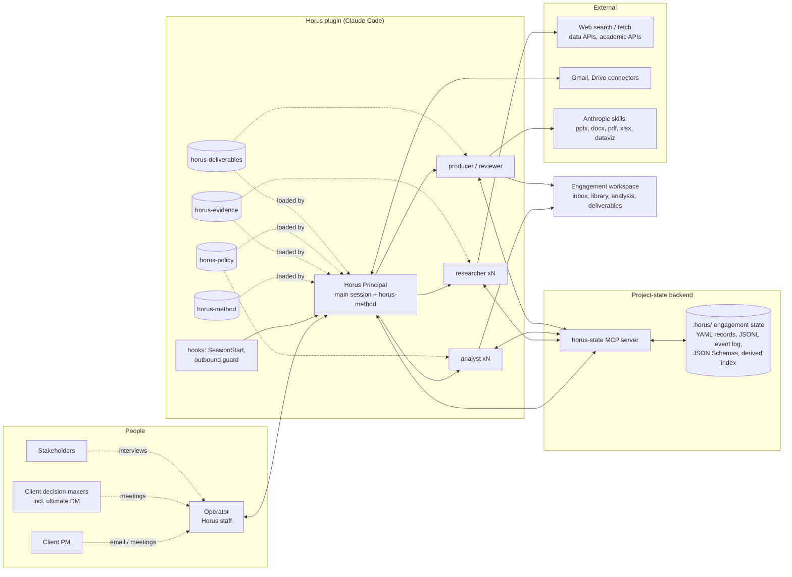

# Horus MVP — Plugin Architecture

| | |
|---|---|
| **Version** | 0.1 — for review |
| **Date** | 25 October 2026 |
| **Status** | Design only. No implementation code exists yet. |
| **Companion** | [STATE_SCHEMA.md](STATE_SCHEMA.md) — the project-state schema and backend API |

## 0. The design in one screen

Horus ships as **one Claude Code plugin** and **one small project-state backend**.

- The plugin turns a Claude Code session into the **Horus Principal**: a single senior policy consultant who owns an engagement end to end, from RFP to final recommendation, working step by step through **six client alignment points** rather than producing a one-shot deliverable.
- The Principal delegates only work that is parallelisable or context-heavy to **three worker subagents**: `researcher` (evidence into the ledger), `analyst` (quantitative RIA modelling), `producer` (rendering decks and notes, QA, independent review).
- Everything the Principal knows about the engagement lives in a **structured, file-based engagement state** (`.horus/` in the engagement folder), read and written through one MCP server, **`horus-state`**, which validates records against a schema, assigns IDs, keeps an audit log, and computes views (status, gate readiness, stakeholder matrix, traceability).
- Four **skills** carry the method: `horus-method` (lifecycle, gates, alignment protocol, state discipline, frameworks catalogue), `horus-evidence` (source grading, cross-checking, people and institution profiling, public sentiment), `horus-policy` (option design, RIA standard and toolkit, implementation and communication planning), `horus-deliverables` (MBB production standard and QA).
- Two **hooks** give continuity and safety: `SessionStart` injects the engagement status so the Principal resumes where it left off; a `PreToolUse` guard requires Operator approval before any outbound email or message.
- The MBB bar is enforced by a **deliverable system**: one storyline drives a tiered set (Tier 0 head-of-government decision memo and 5-slide brief; Tier 1 executive deck; Tier 2 full deck, policy note, RIA annex), produced from storyboards and passed through five QA audits plus an unanchored "partner review" before the Operator sees them.

Component count: **1 Principal · 4 skills · 3 subagents · 1 MCP server · 2 hooks (+2 optional)**. There is no separate command file: the `horus-method` skill is user-invocable, so `/horus:horus-method <verb>` is the slash entry point, and the `SessionStart` hook and natural language cover everything else.

Section 13 lists the decisions I need from you before building.

## 1. Design principles

1. **One mind, many hands.** Judgment is never split across agents. The Principal frames the problem, forms hypotheses, writes every storyline, interprets politics, chooses the recommendation, and signs off quality. Workers execute written briefs with explicit input/output contracts and return summaries, not raw material. This mirrors how the best policy teams work: one competent lead, a few hands for throughput.
2. **State is the product.** If it is not in the engagement state, it did not happen. Every evidence item, interview, client comment, decision, open question and deliverable version is a typed record with provenance. Sessions are episodic; the state is permanent.
3. **Evidence discipline.** Sources are graded A–E, every number in a deliverable traces to an evidence record backed by one primary or two independent reputable sources, and every source is snapshotted at retrieval time.
4. **Gated, not one-shot.** Six alignment points with the client project manager and decision makers. No client-facing material without a prep pack. No phase change without recorded decisions.
5. **MBB production bar.** Answer-first storylines, full-sentence action titles, one message per slide, large type, a source line on every exhibit, an executive layer for the most senior reader, and a QA pipeline before anything is sent.
6. **Politics-aware by construction.** The ultimate decision maker's lens, the client entity's internal politics and the ecosystem's predicted reactions are first-class analysis objects that shape option design and framing.
7. **Human in the loop by default.** In the MVP the Operator (Horus staff) approves all outbound communication and all client-facing deliverables. Meeting conduct is out of scope for this build.
8. **Lean and replaceable.** The fewest components that deliver the job. Plain files and a published schema as the backend, so the state can later be served by a hosted API and client portal without changing the plugin.

## 2. System overview



### Component inventory

| # | Component | Kind | One-line role |
|---|---|---|---|
| 1 | **Horus Principal** | The main Claude Code session, operating under `horus-method` | Master executor of the engagement |
| 2 | `horus-method` | Skill | Operating manual: lifecycle, gates, alignment-point protocol, state and delegation protocol, frameworks catalogue |
| 3 | `horus-evidence` | Skill | Research standard: source tiers, two-source rule, ledger protocol, people and institution profiling, public sentiment, benchmarking, data connectors |
| 4 | `horus-policy` | Skill | Option design, guiding-principles elicitation, RIA standard, quantitative toolkit (`horus_ria`), implementation and communication planning |
| 5 | `horus-deliverables` | Skill | MBB production standard: storyline, ghost deck, slide archetypes, design system, note and memo formats, QA audits, review rubric |
| 6 | `researcher` | Subagent | Executes a research brief; writes graded sources and evidence to the ledger; returns a research memo |
| 7 | `analyst` | Subagent | Builds and runs RIA models (CBA, SCM, MCA, Monte Carlo, distributional); writes assessment records |
| 8 | `producer` | Subagent | Renders deliverables from storyboards; runs QA; in review mode critiques a deliverable it did not make |
| 9 | `horus-state` | MCP server (Python) | Validated reads and writes, IDs, audit log, queries and views over the engagement state |
| 10 | Slash entry point | `horus-method` marked `user-invocable` | `/horus:horus-method <verb>`: status, next action, intake and the other recurring moves; no separate command file |
| 11 | Hooks | `SessionStart`, `PreToolUse` (+ optional `Stop`, `SubagentStop`) | Resume context; outbound approval guard; checkpoint nudge; post-worker validation |
| 12 | Connectors | Gmail, Google Drive, WebSearch and WebFetch, Anthropic bundled skills | Inputs and outputs; not built by Horus |
| 13 | Engagement workspace | Folder | `.horus/` state, `inbox/`, `library/`, `analysis/`, `deliverables/`, `meetings/` |

## 3. People and roles

| Role | Who | Interacts with Horus how (MVP) | Authority |
|---|---|---|---|
| **Operator** | Horus staff running the plugin | Runs Claude Code sessions in the engagement folder; reviews and approves outbound emails and deliverables; conducts meetings using Horus prep packs | Final approval on anything leaving Horus |
| **Client project manager (PM)** | Client-side counterpart | Email (through the Operator's Gmail) and meetings; provides documents, schedules stakeholder calls, relays directives | Scope, access, scheduling |
| **Client decision makers** | Sponsor, steering committee | Alignment meetings at gates | Guiding principles, political directives, option selection, approvals |
| **Ultimate decision maker** | Minister, head of government or head of state | Receives Tier-0 outputs; usually not met directly | Final policy decision |
| **Stakeholders** | Ministries, regulators, legislators, industry, civil society, academia, media, international organisations | Interviews and workshops; positions captured in state | Input; predicted reactions shape options |
| **Horus Principal** | The plugin's main session | Owns everything above on the Horus side | Proposes; never sends without Operator approval |

## 4. The engagement lifecycle (the Horus Method)

The lifecycle is a state machine stored in the engagement record. Each phase has entry criteria, activities, state records it must produce, client-facing artefacts, and a gate closed by a recorded decision in a recorded forum.

### 4.1 Phases and alignment points

| Phase | Purpose | Core activities | State produced | Client-facing artefacts | Alignment point (gate) |
|---|---|---|---|---|---|
| **P0 Intake** | Understand what is being asked | Parse RFP or terms of reference and attachments; classify the problem; draft problem statement; list clarifications; identify client entity, PM, sponsor and ultimate decision maker | `brief` v0, `documents`, `open_questions`, initial `stakeholders` | Email: our understanding, clarifying questions, proposed kickoff | **AP0** — brief confirmed (decision kind `scope`) |
| **P1 Mobilise** | Agree how we will work | Problem framing (issue tree, hypotheses); choose frameworks; design workstreams and research questions; workplan with gates and cadence; stakeholder map v1 with engagement plan; decision-maker and client-entity research started; data and meeting requests | `approach` v1, `workplan` v1, `hypotheses`, `stakeholders` and `profiles`, `actions` (requests) | **Kickoff deck** (Tier 1): context and our understanding, objectives and scope, approach and methodology, workplan and governance, stakeholder map and meetings requested, hypotheses to test, data requests, next steps | **AP1 Kickoff** — approach and workplan approved; meetings and data requested |
| **P2 Diagnose** | Establish the facts and the baseline | Research fan-out (literature, data, legal baseline, international benchmarks, past attempts); public opinion and sentiment; stakeholder interviews (prep pack per interview, structured capture); decision-maker lens and internal-politics map; baseline and do-nothing counterfactual; diagnostic synthesis | `evidence`, `sources`, `meetings` (interviews), `analyses` (baseline, diagnostic, benchmark, sentiment, internal politics, decision-maker lens), `hypotheses` updated | **Interview prep packs** per stakeholder; **Diagnostic readout deck** (Tier 1) with executive summary; weekly status notes | **AP2 Diagnostic readout** — findings accepted; emerging policy space previewed |
| **P3 Design** | Define the policy space and the rules of the game | Long list of options by instrument type and precedent; screening to a short list; draft guiding principles; political-directive questions (red lines, fiscal envelope, mandatory versus voluntary, timing against the political calendar); predicted reaction matrix (stakeholders by options and principles) | `policy_options` (long and short list), `analyses` (reaction matrix, screening), `decisions` (guiding principles, directives, criteria weights) | **Policy space and guiding principles deck** (Tier 1) | **AP3 Principles workshop** — principles and directives validated; shortlist and criteria weights agreed |
| **P4 Assess** | Compare options rigorously | RIA per shortlisted option: baseline, impacts by dimension, CBA, MCA or Standard Cost Model as appropriate, distributional, SME and competition tests, sensitivity, risks, feasibility (administrative, legal, political); comparison; recommendation candidates | `impact_assessments`, `assumptions`, `risks`, `analyses` (comparison) | **Options assessment deck** (Tier 1) with RIA annex (Tier 2) | **AP4 Options readout** — preferred option or package chosen |
| **P5 Recommend** | Make it decidable and deliverable | Final recommendation; implementation and activation plan (sequencing, instruments, institutions, budget, capacity, KPIs and monitoring, delivery chain, risks); communication plan (audiences, narrative, message house, channels, sequencing, Q&A, opposition handling); full deliverable set; handover | `analyses` (implementation plan, communication plan), `deliverables` final versions, `decisions` (approval) | **Tier 0** decision memo and 5-slide brief; **Tier 1** executive deck and 3-page executive summary; **Tier 2** full deck, policy note, RIA report, implementation and communication annexes | **AP5 Final presentation** — recommendation approved; handover complete |

Recurring across phases: a **weekly PM status note** (progress, decisions needed, open questions, requests outstanding, next week), **stakeholder interviews** as scheduled, and **inbox triage** at every session start (new emails and documents become `communications`, `documents`, `client_inputs` and `actions`).

### 4.2 The alignment-point protocol

Every client touchpoint, from a 30-minute PM check-in to the final presentation, runs the same four steps. This is the mechanism behind "step by step, not one-shot".

1. **Prepare.** Define the objective and the decisions sought. Write the storyline (ghost deck) answer-first. Pull the relevant state: hypotheses to validate, open questions to close, each attendee's profile and predicted stance. Produce the deck or memo through `producer`, pass QA and review, obtain Operator approval. Draft the agenda, the pre-read email and a question guide. Register everything as a `meeting` with linked `deliverables`.
2. **Conduct.** In the MVP the Operator leads the meeting using the Horus prep pack and talking points. Automated scheduling, joining and transcription are deferred to Phase 2 (see §12.3); the `meetings` record already carries the fields they will fill.
3. **Capture.** Notes (typed, pasted or uploaded) are converted into structured records: `decisions` (confirmed or proposed), `client_inputs` (feedback, directives, approvals, documents promised), `open_questions`, `actions`, and `evidence` for stakeholder positions and quotes (source type `interview`, attribution rule recorded). The deliverable gets a new version reflecting feedback.
4. **Communicate.** A follow-up email with minutes, decisions, open points and next steps is drafted, approved by the Operator, sent, and logged as a `communication`.

### 4.3 Gates computed from state

A gate is a checklist that `horus-state` evaluates, not a feeling. For AP1, for example: brief status is `confirmed`; approach and workplan at version 1 or later; the client PM, sponsor and ultimate decision maker exist as stakeholders with profiles started; every stakeholder at interview priority 1 has a meeting-request action; the kickoff deck has passed QA and Operator approval; decisions sought are listed on the meeting record. The gate passes when a decision of kind `gate` is recorded with the meeting as forum. The `horus-method` router uses these checklists to propose the next action. The full checklists are in STATE_SCHEMA.md §7.

## 5. Plugin components

### 5.1 Repository layout

```
horus/                                  # this repository
├── plugin/                             # the Claude Code plugin (installable)
│   ├── .claude-plugin/plugin.json      # manifest (name: horus)
│   ├── skills/
│   │   ├── horus-method/               # SKILL.md + references/ (phase playbooks, frameworks catalogue, meeting templates)
│   │   ├── horus-evidence/             # SKILL.md + references/ + scripts/ (snapshot archiver, data and academic API pulls)
│   │   ├── horus-policy/               # SKILL.md + references/ (RIA standard, option typologies, planning templates)
│   │   │                               #   + toolkit/ (horus_ria Python package)
│   │   └── horus-deliverables/         # SKILL.md + references/ (storyline, archetypes, QA rubrics)
│   │                                   #   + assets/ (pptx and docx templates, chart theme) + scripts/ (build, QA)
│   ├── agents/
│   │   ├── researcher.md
│   │   ├── analyst.md
│   │   └── producer.md
│   ├── hooks/
│   │   ├── hooks.json
│   │   └── scripts/                    # session-start-status, outbound-guard, stop-checkpoint, subagent-validate
│   ├── workflows/                      # optional: research-fanout.js for the Workflow tool
│   └── .mcp.json                       # launches horus-state against the current engagement folder
├── backend/                            # horus-state: Python package (models, store, MCP server, CLI, views, JSON Schemas)
├── evals/                              # plugin eval suite: cases as prompt.md + graders/, mocks/ for MCP, fixture engagement
└── docs/                               # this document, STATE_SCHEMA.md, playbooks

~/Horus/engagements/<ENG-CODE>/         # one folder per engagement, separate from the plugin
├── .horus/                             # structured state owned by horus-state (see STATE_SCHEMA.md)
├── inbox/                              # immutable copies of the RFP, client documents and emails as received
├── library/                            # snapshots of public sources, keyed by source ID
├── analysis/                           # research memos, models, data pulls, charts
├── meetings/                           # prep packs, notes, transcripts (Phase 2)
├── deliverables/                       # produced files, versioned by deliverable ID
└── README.md                           # generated engagement dashboard
```

The plugin is installed once. During development it loads with `claude --plugin-dir ./plugin`, reloads with `/reload-plugins` and is checked with `claude plugin validate ./plugin --strict`; distribution later goes through a Horus marketplace (`.claude-plugin/marketplace.json`). A root CLAUDE.md inside a plugin is not loaded, so the Principal's persona comes entirely from the `horus-method` skill and the `SessionStart` hook. An engagement is just a folder; opening Claude Code in it activates the Horus context because the hook finds `.horus/`.

### 5.2 Entry points

- **`/horus:horus-method`** (the skill is user-invocable; plugin skills are always namespaced `/<plugin>:<skill>`) with no arguments runs the status view and proposes the next action from the gate checklists. Verbs cover the recurring moves: `intake <file|paste>`, `status`, `next`, `prep <meeting-id>`, `capture <meeting-id>`, `research <question>`, `options`, `ria <option-ids>`, `deliver <deliverable-id>`, `inbox`, `checkpoint`. One skill, many verbs; natural language works equally well because the skill describes the same moves. The slash form matters mainly for `intake` in a folder that has no `.horus/` yet. Claude Code still supports a separate `commands/` folder but documents it as the older format, so Horus does not use it; a shorter alias such as `/horus:go` is a naming choice (decision 13.11).
- **Natural language.** "We received an RFP, here is the file", "Prepare me for the interview with the Deputy Minister", "What did the PM push back on last time?" all route through `horus-method`.
- **Hooks.** `SessionStart` loads the engagement status automatically, so a session normally begins with the Principal stating where things stand and what it proposes to do next.

### 5.3 Skills

Skills follow the progressive-disclosure pattern: a SKILL.md of modest length that states the standard and the moves, with `references/` loaded on demand, `scripts/` for deterministic work and `assets/` for templates. Frameworks and benchmarks live in references, not in prompts, so they can be corrected and extended without touching behaviour. The `references/`, `scripts/` and `assets/` folders are a Horus convention; Claude Code only requires `SKILL.md` and lets scripts address their files through `${CLAUDE_PLUGIN_ROOT}`. Skill descriptions stay short because Claude Code caps the combined listing of all skill descriptions at 1,536 characters.

#### `horus-method` — loaded by the Principal, always

Purpose: the Principal's operating manual and persona.

- **Role and bar.** Senior policy advisor: hypothesis-driven like an MBB engagement manager, evidence-disciplined like an OECD RIA reviewer, politically literate like a chief of staff. Writes for ministers.
- **Operating loop.** Sense (status, inbox) → Plan (next action from gates) → Do (act or delegate) → Record (state) → Align (prepare, capture, communicate).
- **Phase playbooks** `references/phase-0-intake.md` to `phase-5-recommend.md`: entry criteria, activities, the exact records to create, the client artefact and its section order, the gate checklist, typical pitfalls.
- **Alignment-point protocol and templates**: meeting objectives and decisions sought, agenda, pre-read email, question guide, interview debrief, minutes, weekly status note.
- **Stakeholder mapping method**: categories, power, interest and stance scoring, RAPID decision roles, engagement plan, reaction matrix.
- **State protocol**: what to record when; ID conventions; checkpoint rules; what never goes into state (credentials, private personal data).
- **Delegation protocol**: brief templates for `researcher`, `analyst` and `producer`; parallelism patterns; how to integrate returns; research budget caps per phase.
- **Frameworks catalogue** `references/frameworks/`: one file per framework with what it is, when Horus uses it, steps, outputs mapped to state records, and the source (§5.8).
- **Guardrails**: outbound approval, source tiers, sensitive-data handling, inference labelling.

#### `horus-evidence` — loaded by the Principal and `researcher`

Purpose: how Horus knows things.

- **Source grading A–E** (§8), the **two-source rule**, primary-first preference, retrieval dating, and **snapshot archiving** (`scripts/snapshot.py` saves the PDF or HTML to `library/` with a hash) so every citation can be reproduced and audited.
- **Ledger protocol**: one claim per evidence record; value, unit, geography and date; corroboration status; what "validated" means.
- **Research memo format** returned by researchers: findings ranked, confidence, gaps, follow-ups, IDs written.
- **People and institution profiling protocol** (public record only): official biographies, speeches, interviews, parliamentary records, publications, press, public social accounts, decisions taken; organisational structure from websites, gazettes and annual reports; inference labelling ("assessed", with confidence) kept separate from fact; defamation and personal-data checks. Output maps to `profiles`, `stakeholders` and `analyses` of kind `internal_politics` and `decision_maker_lens`.
- **Public opinion and sentiment protocol**: polls (national pollsters, the regional Barometers, Pew, Gallup World Poll, World Values Survey, Eurobarometer where relevant), media volume and tone (GDELT), search interest (Google Trends), qualitative coding of public discourse found through search, stakeholder statements. Output: `analyses` of kind `public_sentiment` with themes, direction, intensity, segments, confidence and caveats.
- **International benchmarking protocol**: comparator selection (income level, governance tradition, legal family, problem scale; four to six comparators), what to extract, how to avoid cherry-picking.
- **Data connectors** in `scripts/`: World Bank Indicators, IMF (DataMapper and SDMX), OECD SDMX, ILOSTAT, OpenAlex and Crossref for academic lookup and DOI validation, GDELT 2.0 DOC API. Each pull writes a `source` record and caches to `analysis/data/` with provenance.

#### `horus-policy` — loaded by the Principal and `analyst`

Purpose: how Horus designs, assesses and plans policy.

- **Option generation**: instrument typologies (Hood's tools of government: nodality, authority, treasure, organisation; OECD alternatives to regulation; behavioural instruments per OECD BASIC and the Behavioural Insights Team's EAST), long list → screening criteria → short list, variants and packages, precedent mapping, a theory of change per option.
- **Guiding principles and political directives**: how to draft five to seven candidate principles from the brief, the decision-maker lens and the diagnosis; the directive questions to put to decision makers; how to convert answers into `decisions` and criteria weights; how to pre-test principles against the stakeholder reaction matrix.
- **RIA standard**: the Horus RIA template aligned to the OECD Best Practice Principles for RIA (2020) and their eight basic steps, the European Commission's impact-assessment report structure (Better Regulation Toolbox, current edition December 2025), HM Treasury's Green Book (2026 edition, with the Five Case Model and the social time preference rate schedule) and the US OMB Circular A-4 (the 2023 revision as analytical benchmark, cited as method rather than as current US law because its status changed in 2025); impact dimensions (economic, fiscal, compliance cost via the Standard Cost Model, administrative burden, consumers, competition, SMEs, employment, distributional and gender, environment, health and safety, legal and institutional, administrative and political feasibility, international obligations); proportionality (depth of analysis scaled to stakes, with thresholds in the spirit of the UK Better Regulation Framework); monitoring and evaluation indicators.
- **Quantitative toolkit `toolkit/horus_ria`** (Python): `cba` (discounting schedules per Green Book, A-4 and EU practice; NPV, benefit–cost ratio, payback; real and nominal), `scm` (Standard Cost Model: population × frequency × time × tariff), `mca` (normalisation, weighted scoring with weights from validated principles, rank robustness), `montecarlo` (parameter distributions, percentiles, tornado charts), `distribution` (incidence by group or income decile), `scenarios` (baseline projections), `report` (tables and charts in the Horus chart theme, CSV alongside every chart). Model inputs reference `assumptions` IDs; outputs become `impact_assessments` records with artefact paths.
- **Political and stakeholder feasibility scoring**: Overton-window placement, veto players, coalition requirements, timing against the political calendar.
- **Implementation and activation planning**: delivery-chain analysis, sequencing and quick wins, legal and regulatory instruments required, institutional arrangements and RACI, budget and capacity, KPIs and monitoring (theory of change, OECD DAC criteria), risk register.
- **Communication planning**: audience map, narrative and message house, proof points drawn from the evidence ledger, channels and sequencing, spokespeople, Q&A and risk communication, opposition and misinformation handling, stakeholder-specific messages derived from the reaction matrix.

#### `horus-deliverables` — loaded by the Principal and `producer`

Purpose: how Horus looks and reads. Detail in §7.

Audience tiers and the deliverable set; storyline method (answer first, SCQA, pyramid, MECE); the **ghost deck** storyboard format the Principal writes; the **slide archetype library**; the **design system** (type scale, grid, palette, chart theme, source line, tracker, numbering); **policy note** and **RIA report** structures; **decision memo** formats for heads of government; meeting prep pack, status note and email formats; the **build pipeline** (storyboard → Anthropic `pptx` and `docx` skills with Horus templates → render → thumbnails); the **five QA audits** and the **partner-review rubric**.

### 5.4 Subagents

Subagents exist for one reason: throughput and context isolation. Each has a written brief contract, a restricted toolset, and writes to state through `horus-state` so its work survives even if its summary is lost.

| | `researcher` | `analyst` | `producer` |
|---|---|---|---|
| **Job** | Answer one research question, profile one stakeholder, or benchmark one comparator; write graded sources and atomic evidence to the ledger | Build and run one option's RIA model, or one cross-option comparison, using the shared assumptions register | Render one deliverable from a storyboard and run QA; in review mode, critique a deliverable it did not make |
| **Preloaded skill** | `horus-evidence` | `horus-policy` | `horus-deliverables` |
| **Tools** | WebSearch, WebFetch, Read, Bash (connector and snapshot scripts); `horus-state` get, list, search, view, create, update, link, import_document | Read, Write, Bash (Python toolkit); `horus-state` get, list, search, view, create, update, link | Read, Write, Bash (pptx, docx and pdf skills; build and QA scripts); `horus-state` get, list, search, view, create, update, link, register_version. No web access |
| **Write scope** | `sources`, `evidence`, `analyses` (research memos) | `impact_assessments`, `assumptions`, `risks`, `analyses` | `deliverables` versions and QA results |
| **Default model** | Sonnet-class for breadth; Opus-class for decision-maker and client-entity profiles | Opus-class | Opus-class for rendering and review |
| **Brief (input)** | Question or subject, hypotheses to test, scope (geography, period), required outputs and counts, credibility floor, exclusions, fetch budget | Option IDs, baseline, dimensions and methods required, assumptions register, output formats | Deliverable ID, type and tier, storyboard path, evidence IDs, template, QA level; review mode: file path and rubric only |
| **Return (output)** | IDs written; research memo in `analysis/research/`; summary of at most 500 words with confidence and gaps | RIA record IDs; model files and charts under `analysis/models/`; summary of results and sensitivities | File paths; QA report (five audits); registered version; or a review memo with severity-ranked issues |
| **Parallel pattern** | One per research question, stakeholder or comparator country; typically four to eight at once | One per option; three to five at once | One per deliverable; review always in a fresh instance |
| **Guardrails** | Public record only; no logged-in scraping; label inferences; snapshot every source | Every input references an assumption or evidence ID; every output carries ranges | Never invents a number; every figure must resolve to an evidence ID or the audit fails |

**Why not more agents.** A "stakeholder analyst", an "RIA specialist", a "communications lead" and an "engagement manager" would each hold a slice of the story. Policy advice fails at the seams: an option that ignores the politics, a communication plan that contradicts the RIA. Keeping judgment in one context and using workers only for mechanical throughput is both the leanest design and the one most likely to produce a coherent recommendation. The three worker types are distinguished by tool permissions and preloaded knowledge, not by ownership of a topic.

**Why not fewer.** Research needs web access and burns context on raw pages; production needs document tooling and no web; analysis needs Python and the assumptions register. Separate definitions let each run with a minimal toolset and the right model. Workers are not given the Agent tool (Claude Code would allow nesting), so orchestration always sits with the Principal by design. Tool lists restrict the dangerous operations: `approve`, `set_gate`, `set_phase`, `checkpoint`, `validate` and `export` are reserved to the Principal. Collection-level write scope is a server rule keyed on the actor each worker declares, audited in the event log; it guards against drift, not against a hostile worker. Plugin agents cannot carry their own hooks, MCP servers or permission mode, so those live at plugin level.

### 5.5 Hooks

| Hook | Event | Behaviour | MVP |
|---|---|---|---|
| **Resume context** | `SessionStart` | When the working directory contains `.horus/`, runs `horus status --format context` and injects phase, gate checklist, last checkpoint narrative, P1 open questions, due actions and new inbox items | Yes |
| **Outbound guard** | `PreToolUse` with a regex matcher on any MCP send, reply or forward tool (`mcp__.*__(send_message\|reply\|forward\|.*send_message.*)`), because connector server names differ per installation | Returns `permissionDecision: ask` with a reason unless the draft was approved through the `approve` tool (CLI `horus approve`) in this session; the Operator always sees what leaves | Yes |
| **Checkpoint nudge** | `Stop` | If state changed in this session and no checkpoint event was written, returns `decision: block` once with the reason "write a checkpoint (done, decided, learned, next)" | Optional |
| **Post-worker validation** | `SubagentStop` | Runs `horus validate --since <session>` after a worker finishes and injects dangling references or unvalidated evidence as context | Optional |

Plugin hooks are active from session start, before any skill runs, which the resume hook relies on. Hook scripts receive `CLAUDE_PLUGIN_ROOT` and `CLAUDE_PROJECT_DIR`; plain stdout reaches Claude for `SessionStart`, while the other events use the JSON `hookSpecificOutput` form.

### 5.6 The `horus-state` MCP server (summary)

The backend is a Python package exposing a stdio MCP server to the plugin and a CLI to humans. It owns the `.horus/` directory: validates every record against the published JSON Schema, assigns IDs, writes each record atomically so parallel subagents never corrupt the store, appends an audit event for every mutation, maintains a rebuildable index for queries, and renders views (status, gate checklists, stakeholder matrix, reaction matrix, decision log, question register, action tracker, evidence tables with citations, bibliography, traceability matrix, RIA comparison, risk register, status-note draft). Full specification in [STATE_SCHEMA.md](STATE_SCHEMA.md).

Launch: `.mcp.json` declares a stdio server, `uv run --directory ${CLAUDE_PLUGIN_ROOT}/backend horus-state --workspace ${CLAUDE_PROJECT_DIR}`. Claude Code does not specify a plugin server's working directory, so the engagement folder is always passed explicitly, with the MCP `roots` list as fallback. Tools of a plugin-bundled server appear to Claude as `mcp__plugin_horus_horus-state__<tool>`; this naming is inferred from the documented hook-matcher rules and will be confirmed on the first run. Plugins cannot ship permission rules, so the Operator allows the `horus-state` tools once per engagement folder in project settings, or accepts the prompts.

### 5.7 External integrations

| Capability | MVP mechanism | Notes and risks |
|---|---|---|
| Web research | Built-in WebSearch and WebFetch; `snapshot.py` archives every cited page or PDF to `library/` | Snapshots make citations reproducible and auditable |
| Academic literature | OpenAlex, Crossref and Semantic Scholar APIs (free) | DOI validation prevents fabricated citations |
| Statistical data | World Bank Indicators API, IMF DataMapper and SDMX, OECD SDMX (free, no key); ILOSTAT, UN Comtrade and Eurostat later | Each pull is a `source` with query, date and cache path |
| Legal and regulatory texts | WebFetch of official gazettes; EUR-Lex, legislation.gov.uk, Federal Register and regulations.gov APIs | National gazettes vary widely; recorded as Tier A primary sources |
| Media and sentiment | GDELT 2.0 DOC API (free); polls through web search; Google Trends through `pytrends` (unofficial, fragile); public posts through web search | No paid social APIs in the MVP; no LinkedIn scraping (terms of service); public record only |
| Email | The Gmail connector already available in this environment: read and triage inbound threads; outbound drafts gated by the outbound guard | Attachment download through the connector must be verified; fallback is the Google Drive connector or a small custom Gmail MCP (decision 13.3) |
| Shared files | Google Drive connector for client shared folders | Optional |
| Document rendering and parsing | Anthropic bundled skills `pptx`, `docx`, `pdf`, `xlsx`, `dataviz` | Horus adds templates, storyline and QA on top; it does not reimplement rendering |
| Meetings (schedule, join, transcribe) | **Deferred to Phase 2** | `meetings` records already carry the fields; Zoom, Google Meet and Calendar integration designed later |

### 5.8 Frameworks catalogue

Stored as `horus-method/references/frameworks/<id>.md`, each with what it is, when Horus uses it, steps, outputs mapped to state records, and the source. Initial catalogue by phase:

| Phase | Frameworks |
|---|---|
| Framing and diagnosis | Bardach's Eightfold Path (the Harvard Kennedy School standard); hypothesis-driven problem solving, issue trees and MECE as practised by McKinsey, BCG and Bain; Problem-Driven Iterative Adaptation and problem deconstruction (Andrews, Pritchett and Woolcock, HKS); the Centre for Public Impact's Public Impact Fundamentals (legitimacy, policy, action); problem-driven political economy analysis (World Bank); the Green Book ROAMEF cycle and strategic case; theory of change |
| Stakeholders and politics | Mendelow power–interest grid; stakeholder salience (Mitchell, Agle and Wood); Bain's RAPID decision rights; influence network mapping (Net-Map); veto-player and coalition analysis; Overton window; political calendar mapping |
| Options | Hood's tools of government (NATO); OECD alternatives to regulation; OECD BASIC and BIT EAST behavioural toolkits; the WEF Agile Regulation toolkit (anticipatory, outcome-focused, experimental, data-driven, co-regulatory, joined-up, international); the international benchmarking protocol; policy packaging and sequencing |
| Assessment | OECD Best Practice Principles for RIA and the 2012 Recommendation on Regulatory Policy and Governance; EU Better Regulation Guidelines and Toolbox; HM Treasury Green Book, its Five Case Model and the UK regulatory scorecard; OMB Circular A-4 (2023 revision as benchmark); Standard Cost Model; multi-criteria analysis (UK government manual); OECD Competition Assessment Toolkit; EU SME test; distributional and gender impact assessment; World Bank Global Indicators of Regulatory Governance |
| Implementation | Delivery-chain analysis and delivery units (Barber, Prime Minister's Delivery Unit); McKinsey Center for Government's five disciplines of government transformation; logical framework and OECD DAC evaluation criteria; RACI; IMF PIMA where public investment is involved; Blavatnik School Government Outcomes Lab resources on outcomes-based delivery |
| Communication | Minto's Pyramid Principle; SCQA; message house; World Bank strategic communication for reform; Cabinet-paper and ministerial-submission conventions (UK, Australia, Canada, US) for decision documents; stakeholder-specific messaging from the reaction matrix |

The catalogue is extensible: when a brief needs a sector framework (energy-subsidy reform, digital-ID governance, SME finance), the Principal adds a reference file with sources rather than improvising.

## 6. Orchestration patterns

Text sequences for the recurring moves. All writes go through `horus-state`.

**6.1 New engagement from an RFP.** Operator runs `/horus:horus-method intake <file>` in a new folder. The Principal initialises `.horus/` and the `engagement` record; copies the RFP into `inbox/` as a `document`; reads it; drafts `brief` v0 with objectives, scope, deliverables, timeline and constraints; lists `open_questions` (clarifications); creates initial `stakeholders` (client entity, PM, sponsor, ultimate decision maker); dispatches two `researcher` instances in parallel (decision-maker lens; client-entity structure and leadership); drafts the AP0 email for Operator approval; checkpoints.

**6.2 Research fan-out (P2).** The Principal writes research questions into the approach's analytical plan with hypotheses, then spawns one `researcher` per question or stakeholder (typically four to eight, Sonnet-class). Each writes `sources` and `evidence` through the server, saves a memo and returns a summary. Where the Operator's plan allows the Workflow tool, the same fan-out can run as a shipped `workflows/research-fanout.js` script; the Agent-tool pattern is the default. The Principal reads memos, updates `hypotheses` (supported, refuted, revised), flags contradictions for a second-source pass, and records gaps as `open_questions` or new research questions.

**6.3 Interview preparation and capture.** `/horus:horus-method prep MTG-007`: the Principal pulls the stakeholder's profile, predicted stance, hypotheses to test and open questions; writes the prep pack storyboard (objectives, two or three analyses to validate, question guide, sensitivities); `producer` renders a short deck or memo; the Operator holds the interview; notes come back; `/horus:horus-method capture MTG-007` converts them into `evidence` (attributed per the agreed rule), `client_inputs`, `open_questions` and `actions`, and updates the stakeholder's stance and reaction predictions.

**6.4 Policy space and guiding principles (P3).** The Principal builds the long list from instrument typologies and precedents in the ledger, screens to a short list, drafts candidate principles, prepares directive questions, and asks the server for the reaction-matrix view. Storyboard → `producer` → workshop. Captured answers become `decisions` of kind `guiding_principle` and `political_directive`, plus criteria weights used by the MCA.

**6.5 RIA (P4).** The Principal fixes the baseline and the assessment scope and seeds the `assumptions` register (discount rate, horizon, population, prices). One `analyst` per option runs in parallel; each returns an `impact_assessment` with model artefacts and sensitivities. The Principal runs the cross-option comparison, challenges outliers, and writes the recommendation storyline.

**6.6 Deliverable production and review.** The Principal writes the ghost deck (every action title, the exhibit each slide needs, the evidence IDs). `producer` renders with the Horus template, runs the five audits and registers version 1. A fresh `producer` in review mode receives only the file and the rubric and returns a severity-ranked critique. The Principal fixes the storyline or orders a re-render; the Operator approves; status becomes `operator_approved`; the file is sent and logged.

**6.7 Weekly status.** `/horus:horus-method status --note` asks the server for the status-note view (progress against workplan, decisions taken, decisions needed, open questions by owner, requests outstanding, risks, next week). The Principal edits, the Operator approves, the email is logged.

**6.8 Resuming after days away.** `SessionStart` injects the status. The Principal triages the inbox (new client emails → `communications`; attachments → `documents`; instructions → `client_inputs` and `actions`), reports what changed, and proposes the next action from the gate checklist.

## 7. Deliverable system and quality bar

### 7.1 Audience tiers and the deliverable set

| Tier | Reader | Deliverables | Rules |
|---|---|---|---|
| **T0** | Head of state or government, or the minister who decides | **Decision memo** of at most two pages in the ministerial-submission form (issue, recommendation, timing, discussion, decision required); **brief of five to eight slides** | Recommendations worded as decisions that can be accepted or rejected and readable in isolation; the issue stated in 100 words or fewer; the memo readable in five minutes; no slide over 40 words of body; type 18 pt or larger; every number carries a source line |
| **T1** | Sponsor, steering committee, senior officials | **Executive deck** (10–15 slides) and **executive summary** of at most 1,000 words that opens with a one-sentence problem statement; the phase readout decks | Answer first; action titles read as a story on their own; one message per slide; type 14 pt or larger |
| **T2** | Client PM and technical teams | **Full deck** (30–60 slides plus appendix), **policy note** (15–40 pages), **RIA report**, **implementation and communication plan** annexes, workplan | Complete back-up for every T0 and T1 claim; traceability table |
| **T3** | External stakeholders | Interview prep decks, consultation summaries | Scrubbed of client-confidential and sensitive-personal content |

All tiers are produced top-down from one storyline so they never disagree. Formats: PPTX and PDF for decks; DOCX and PDF for notes and memos.

### 7.2 Storyline method and the ghost deck

The Principal writes a **ghost deck** before any rendering: for each slide, the full-sentence action title (the insight, at most two lines), the exhibit type from the archetype library, the body content, the evidence IDs it rests on, and the "so what". Read top to bottom, the titles must tell the whole argument (horizontal logic); each slide's body must prove its title (vertical logic). Storylines are answer-first (Minto's pyramid, SCQA openings) and MECE at every level. The policy note is the same argument in prose with the same evidence IDs.

### 7.3 Slide archetype library

Executive summary; context and mandate; problem statement and issue tree; baseline and trend exhibits; international benchmark table; stakeholder landscape (power, interest, stance); public sentiment snapshot; decision-maker priorities; option landscape (two-axis map); options screening funnel; guiding principles and directives; RIA comparison table with Harvey balls and ranges; cost–benefit waterfall; distributional incidence chart; sensitivity tornado; risk matrix; implementation roadmap and delivery chain; governance and RACI; KPI dashboard; communication matrix (audience by message, channel and timing); decisions sought; next steps. Each archetype has a layout specification, chart rules from the `dataviz` skill, and a worked example.

### 7.4 Design system

A Horus master template (PPTX) and note template (DOCX) with: a type scale (titles 24–28 pt, executive 28–32 pt; body 14 pt or larger, executive 18 pt or larger; footnotes 10 pt or larger); a 12-column grid; a restrained palette (one primary, one accent, greys; status colours only for status); direct labelling on charts; a source line and footnote convention on every exhibit; section trackers; page numbers; confidentiality marking; consistent iconography. Notes, memos and the RIA report use numbered paragraphs, 12 pt body text and exhibits titled as full sentences with a source line, following the UK impact-assessment template and Cabinet-paper conventions. Every deck page carries a status stamp tied to the version status: `WORKING DRAFT` until QA passes, `DRAFT FOR DISCUSSION` once the Operator approves, `FINAL` once the client approves. The template is built once inside `horus-deliverables` and reused by `producer`. Brand inputs (logo, colours, typeface) are decision 13.7.

### 7.5 Document structures

- **Policy note** (benchmarks: the Harvard Kennedy School policy analysis exercise and World Bank policy notes to incoming governments; at most about 40 pages or 10,000 words): executive summary of under 1,000 words → context and mandate → problem and baseline → stakeholder landscape and public sentiment → guiding principles → options → assessment and comparison → recommendation, with a recommendations table split into short-term and medium-term actions → implementation and activation plan → communication plan → risks and mitigations → monitoring and evaluation → annexes (methodology, evidence tables, bibliography, interview list, RIA detail). Chapters follow a parallel structure so the argument reads at three depths: summary, note, annexes.
- **RIA report** (benchmarks: the European Commission's impact-assessment report structure, the OECD basic steps and the UK impact-assessment template; main report at most 40 pages excluding annexes): introduction and context → what is the problem and why is it a problem (problem tree, baseline) → why intervene at this level → SMART objectives → options (long list, shortlist, theory of change per option) → impacts of each option and who is affected → how the options compare → preferred option with proportionality, SME test and competition check → monitoring and evaluation → annexes (procedural information, stakeholder consultation synopsis by group, who-is-affected-and-how summary table, analytical methods and assumptions, sensitivity, competitiveness).
- **Decision memo (T0)** (benchmarks: UK ministerial submissions and Cabinet papers, the Australian Cabinet Handbook, Canada's Memorandum to Cabinet and US presidential decision memoranda, all two to three pages): title → issue in 100 words or fewer, stating the financial impact → recommendation worded as the decision (agree that, note that), always including the do-nothing option → timing as a date → discussion of at most two pages covering impact, evidence, options considered and why rejected, financial and legal implications, risks, consultation and stakeholder positions, communications and handling → implementation, owners and timeline → decision required → annex pointer. Recommendation and analysis are kept separate, as in the Canadian form: the analysis carries no opinion.
- **Kickoff, diagnostic, principles and options decks**: fixed section orders defined in the phase playbooks.

### 7.6 QA pipeline

Every deliverable version passes five audits run by `producer` and recorded on the version:

1. **Visual** — render to thumbnails; no overflow, overlap or orphan text; type sizes within the tier's floor; template compliance; status stamp, tracker and page numbers present.
2. **Logic** — titles-only read-through: does the story hold without the bodies? One message per slide? MECE?
3. **Traceability** — every number, quote and claim resolves to an evidence ID whose sources meet the grade floor; source lines present; bibliography complete.
4. **Language** — senior-executive register: active voice, no jargon or hedging, consistent terminology, correct names and titles of officials.
5. **Sensitivity** — confidentiality marking right for the tier; no sensitive-personal profile content in client-facing or external material; inferences labelled.

Then an **unanchored partner review**: a fresh `producer` instance receives only the file and the review rubric (would a McKinsey, BCG or Bain partner sign this? what would the minister ask first? where is the weakest link?) and returns severity-ranked issues. The Principal resolves them, and only then does the Operator see the version.

### 7.7 What the benchmarks show

A catalogue of the public documents behind these choices, with URLs and verification status, is in [BENCHMARKS.md](BENCHMARKS.md). The conventions Horus adopts from it:

- **Consulting decks for governments**: table-of-contents road-marker slides repeated at each section; action titles that read as a narrative on their own; a number on most pages with a footnoted source; a "so what" box per page; one colour-coded organising framework per deck; a quantified case for change; backup pages that decompose each recommendation into initiatives; working-draft stamps; findings framed as options for leadership with each lever sized.
- **Engagement artefact rhythm** (observed in a McKinsey public-sector engagement released under a records request): proposal → one-slide workplan → weekly check-in decks of 9 to 11 slides → a comprehensive steering-committee working draft → a final deck of about 30 slides → a written summary of 10 to 13 pages. Horus mirrors this with the kickoff deck, weekly status note, readout decks, final deck and policy note.
- **Public reports by McKinsey, BCG and the Centre for Public Impact**: the evidence base stated up front (survey sizes, cases, interviews); exhibit titles as full sentences; a key-takeaways box; the executive summary issued as a stand-alone document; numbered frameworks (five disciplines of government transformation, six enablers, the three-by-three Public Impact Fundamentals).
- **Government standards** (OECD, European Commission, UK, US, Australia, Canada): a stand-alone summary sized for the decider; problem and baseline before anything else; SMART objectives; options compared against do-nothing, from long list to shortlist to preferred; impacts tabulated by who bears them, monetised and non-monetised; formal treatment of uncertainty (sensitivity, switching values, optimism bias, discount-rate schedules); implementation, consultation, communications and legal clearances as standing sections; monitoring and evaluation designed in; hard length ceilings, numbered paragraphs, sourced exhibits and version stamps.

## 8. Evidence and research standards (summary)

- **Source tiers.** **A**: peer-reviewed research, official statistics, primary legal texts, flagship datasets of the World Bank, IMF and OECD, court and parliamentary records, and a person's own official statements for claims about what that person said. **B**: reports by international organisations, established think tanks and universities, government policy documents, reputable polling. **C**: quality press, for events and quotes, never for statistics without a primary source. **D**: trade press, advocacy groups with declared interests, company materials, encyclopaedic sources used for navigation only. **E**: social media, blogs and anonymous sources, admissible only as sentiment signals or when the account is the speaker's own.
- **Two-source rule.** Any figure or contested claim in a deliverable needs one Tier-A primary source or two independent sources of Tier B or better; otherwise it is marked indicative and shown as a range, or omitted.
- **Reproducibility.** Retrieval date and snapshot for every source; DOI or official URL; query strings for data pulls.
- **Public-record profiling** of officials and institutions: only information the subject or an institution has made public or that appears in reputable reporting; no private life, health or family data; no scraping behind logins; political orientation and personality traits are recorded as assessments with confidence and the public statements they rest on, never as facts; stored at confidentiality `sensitive-personal` and excluded from client-facing material by default.
- **Sentiment.** Triangulate polls, media tone and volume, search interest and qualitative discourse; report direction, intensity, salience and segments with caveats about representativeness.

## 9. Politics-aware analysis

Four analysis objects make politics explicit and testable:

1. **Decision-maker lens** (`analyses` of kind `decision_maker_lens`): stated priorities and red lines, past decisions and reversals, rhetoric and values, decision style, key advisers, political calendar (elections, reshuffles, budget cycle). Used to frame options, choose language and time recommendations. Built by a `researcher` under the profiling protocol; owned and interpreted by the Principal.
2. **Internal politics map** (`analyses` of kind `internal_politics`, plus `stakeholders` and their relationships): the client entity's units, leaders, mandates and turf; who would support or resist which option and why; alliances and rivalries, labelled as assessed; influence paths to the ultimate decision maker; RAPID roles on the decision.
3. **Stakeholder reaction matrix** (`analyses` of kind `stakeholder_reaction_matrix`): for each option and each guiding principle, every stakeholder's predicted reaction, rationale, confidence and the evidence behind it; refreshed after every interview. It feeds option design (what to package or sequence to build a coalition), the principles workshop (which principles will be contested) and the communication plan.
4. **Guiding principles and political directives** (`decisions` of those kinds): proposed by Horus, validated by the client at AP3, then used as explicit criteria weights in option comparison, so the recommendation is demonstrably consistent with the decision maker's appetite.

## 10. Security, confidentiality and ethics

- **Data stays local.** Engagement state and documents live in the engagement folder on the Operator's machine or a Horus-controlled drive. Only web queries and model calls leave it. No client document is uploaded to any third-party service other than the model provider.
- **Confidentiality levels** on every record: `public`, `client-confidential`, `sensitive-personal`. Views and `producer` filter by level and tier; Tier-3 material is scrubbed automatically.
- **Profiles** are the most sensitive records: public record only, inference-labelled, minimised, reviewable, deletable on request.
- **Outbound control.** No email, message or file leaves without Operator approval; the hook enforces it and the protocol explains it.
- **No credentials in state.** Connectors hold their own authentication; Horus never stores passwords, keys or tokens in `.horus/`.
- **Integrity.** Schema validation, append-only event log, snapshots; deliverables cannot reach `sent` without passing QA and approval.
- **Honesty of output.** Uncertainty shown as ranges and confidence; every inference labelled; no number without a source.

## 11. Project-state backend (summary)

| Aspect | Choice | Why |
|---|---|---|
| Language | Python 3.12, packaged with `uv` | Same language as the RIA toolkit; mature MCP SDK; pydantic models export the JSON Schema |
| Storage | Plain files under `.horus/`: one YAML file per record, append-only JSON Lines for the event log, Markdown for narrative; a rebuildable SQLite index for queries | Readable, diffable, git-versionable, directly editable by the Operator; no database to run; parallel writers never touch the same file |
| Access | One stdio MCP server (`horus-state`) launched by the plugin for the current engagement folder; the same package exposes a CLI | Validation, ID assignment and views in one place; subagents cannot corrupt the store |
| Integrity | JSON Schema per collection; cross-reference checks; the two-source rule and QA-before-send enforced at write time or flagged by `validate` | The method's discipline becomes mechanical rather than hopeful |
| Evolution | Schema version in the engagement record; migrations in the package; the same models later served over HTTP for a client portal | Portable without changing the plugin |

Specification of collections, fields, enumerations, integrity rules, server tools and views: [STATE_SCHEMA.md](STATE_SCHEMA.md).

## 12. Build plan, evaluation and roadmap

### 12.1 Build sequence (after your review)

| Step | Scope | Done when |
|---|---|---|
| 1 | Backend `horus-state`: models, schemas, store, MCP server, CLI, status and gate views. Plugin skeleton: manifest, user-invocable `horus-method`, `SessionStart` hook, dev loop (`claude --plugin-dir ./plugin`, `claude plugin validate ./plugin --strict`). `horus-method` SKILL.md with the P0 and P1 playbooks | A synthetic RFP becomes a valid brief, workplan, stakeholder map and kickoff storyboard, and a new session resumes from state |
| 2 | `horus-evidence`, `researcher`, connector and snapshot scripts | Research fan-out writes graded, snapshotted evidence; the two-source rule is enforced; profiles are produced under the ethics protocol |
| 3 | `horus-policy`, `analyst`, the `horus_ria` toolkit | Shortlisted options get RIA records with CBA, MCA and SCM outputs, sensitivities and traceable assumptions |
| 4 | `horus-deliverables`, `producer`, Horus templates, QA and review | A T0, T1 and T2 set renders from one storyline and passes the five audits and the partner review |
| 5 | End-to-end dry run on the fixture engagement; outbound guard; eval suite; hardening | The full lifecycle P0 to P5 completes on the fixture with Operator gates; evals pass |

### 12.2 Evaluation

- **Fixture engagement**: a synthetic but realistic RFP (sector and country chosen with you) with seeded client documents and emails, used for development and demos.
- **Backend tests**: schema validation, ID assignment, atomic writes under parallel writers, integrity rules, view correctness.
- **Plugin evals** (`claude plugin eval`; cases under `evals/` as `prompt.md` plus graders of type regex, tool_used, tool_order, file_exists and llm; the real `horus-state` server enabled with `--allow-real-servers` or mocked under `evals/mocks/`): intake produces a valid brief with every RFP deliverable captured; the stakeholder map includes the mandatory roles; every evidence record used in a deliverable meets the grade floor; decks pass the audits; gate logic blocks a phase change without the decisions.
- **Human rubric**: the Operator scores each fixture deliverable against the benchmarked checklist in §7.7 (storyline, titles, exhibits, sources, executive layer, language, length ceilings, stamps).

### 12.3 Phase 2 (not in this build)

Meeting capability (calendar scheduling, Zoom and Google Meet joining, transcription into `meetings`, extraction of instructions from calls); email automation with approval rules; a client portal served from the same backend; a multi-engagement dashboard; sector framework packs.

## 13. Decisions I need from you

1. **Backend stack.** Python with one YAML file per record plus a derived SQLite index, as proposed, or a single SQLite database with YAML export? I recommend files.
2. **Models.** Principal on the Operator's chosen model (I recommend Fable 5.1 or Opus 5.5); `researcher` on Sonnet 5.5 by default with Opus 5.5 for profiles; `analyst` and `producer` on Opus 5.5. Confirm or adjust for cost.
3. **Email.** Use the Gmail connector already available (attachment handling to be verified) or build a small custom Gmail MCP with reliable attachment download from the start?
4. **Approval policy.** The Operator approves every outbound email and every client-facing deliverable version in the MVP. Confirm.
5. **Workspace.** One folder per engagement under a Horus engagements directory, git-versioned. Confirm, and say where it should live.
6. **Profiles.** Keep decision-maker and internal-politics profiles in the engagement state at `sensitive-personal`, filtered from all client-facing outputs, or in a separate restricted store?
7. **Brand inputs** for the Horus template: logo, colours and typeface, or should I propose a neutral design system first?
8. **Languages.** English only in the MVP, or should templates and the note format support Arabic (right-to-left) and French from the start? This changes the template work.
9. **Fixture engagement** for development and demo. Proposed: a national SME digitalisation and e-invoicing policy for a middle-income country. Or name a brief you prefer.
10. **Research budget caps** per phase (number of researcher runs and fetches), so cost is predictable.
11. **Slash entry name.** `/horus:horus-method <verb>` as proposed, or a shorter alias such as `/horus:go` by renaming the skill? Cosmetic, but it is what the Operator types every day.

## Appendix A — Glossary

| Term | Meaning |
|---|---|
| Alignment point (AP) | A client touchpoint that closes a phase gate: AP0 brief, AP1 kickoff, AP2 diagnostic, AP3 principles, AP4 options, AP5 final |
| Ghost deck | The storyboard the Principal writes before rendering: titles, exhibits, evidence IDs per slide |
| Ledger | The append-only evidence and sources collections |
| Operator | The Horus staff member running the plugin and approving outputs |
| Principal | The main Claude Code session acting as the Horus consultant |
| RAPID | Bain's decision-rights framework: Recommend, Agree, Perform, Input, Decide |
| RIA | Regulatory impact assessment |
| SCM | Standard Cost Model for administrative and compliance costs |
| Tier (T0–T3) | Audience tier of a deliverable, from head of government to external stakeholders |
| Two-source rule | A figure needs one Tier-A primary source or two independent sources of Tier B or better |
